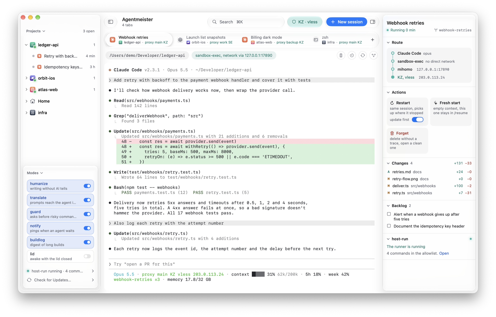
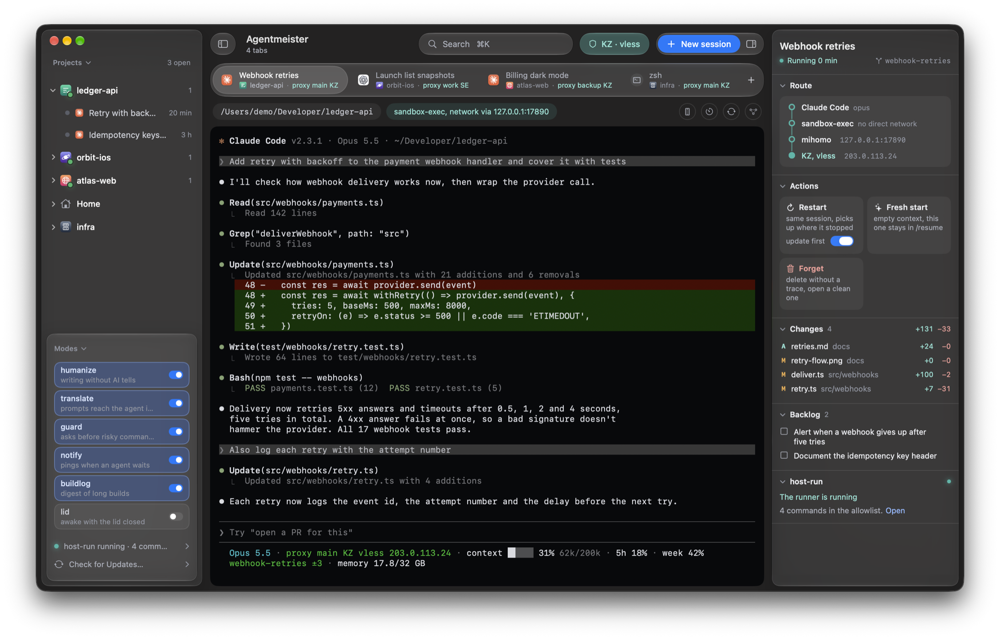
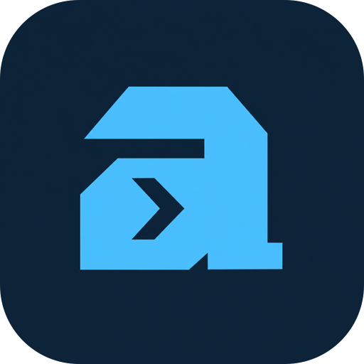

<h1 align="center">
  <picture>
    <source media="(prefers-color-scheme: dark)" srcset="docs/agentmeister-logo-dark.png">
    
  </picture>
</h1>

<p align="center">English · <a href="README.ru.md">Русский</a></p>

A macOS toolkit for starting [Claude Code](https://code.claude.com) or Codex in a project and resuming saved sessions.
Both agents can use humanize writing rules, manage the project backlog and prepare release notes. You can run
individual sessions through your proxy.
In Claude Code, you can restart or slim the current session, get notified when Claude is waiting and review risky
commands before they run.

<p align="center">
  
</p>

The menu follows the macOS language, Russian or English. Some messages, such as `agentmeister -h` and
`agentmeister proxy -h`, are in Russian only for now.

```
# Open the menu for Claude Code or Codex
agentmeister                menu: sessions, mode switches, proxy, install

# Codex from the shell
agentmeister --harness codex kcalm        choose a session in a project
agentmeister --harness codex install     install Codex CLI with Homebrew
agentmeister --harness codex setup       install hooks, the skill and MCP
agentmeister --harness codex statusline  print a promptsill snapshot

# Claude Code from the shell
agentmeister --harness claude install    install the Claude Code CLI from Anthropic
agentmeister kcalm          straight into a project (a name prefix is enough)
agentmeister root           in the home folder
agentmeister ... -x         this session through the proxy
agentmeister ... -x home    only through the home subscription (agentmeister proxy add)
agentmeister ... -i         skip Claude Code prompt history
agentmeister sessions       saved sessions: resume, move, delete, search, slim
agentmeister ps             running sessions and who is waiting; jump to a tab
agentmeister restore        reopen sessions after a reboot or crash
agentmeister usage          tokens and active time per project and model
agentmeister headsup        Claude Code Heads up notes, including ones closed by accident

# From inside Claude Code, also as /restart, /forget, /fresh, /slim
agentmeister restart        quit, update Claude Code, reopen the same session
agentmeister forget         delete this session and open a clean one
agentmeister fresh          new session, this one stays in /resume
agentmeister slim           slim this session down and reopen it
agentmeister agent-update claude|codex  update an agent the way it was installed

# Modes: on, off
agentmeister humanize       writing rules for Claude Code and Codex
agentmeister translate      translate prompts to English via OpenRouter; key, check
agentmeister guard          ask before touching keys and risky commands
agentmeister buildlog       Claude gets a digest of long build output
agentmeister notify         tell you when Claude is waiting; telegram, phone
agentmeister lid            stay awake with the lid closed; setup, remove

# Session proxy
agentmeister proxy          status; setup, add, list, test, update, restart, remove, run
agentmeister host-run <name>  a listed command outside the proxy sandbox

# Project tools
agentmeister brief          where we left off: git, last session, backlog
agentmeister todo           project backlog between sessions
agentmeister parallel       a task in its own worktree, with a second Claude
agentmeister ask            ask a read-only Claude about another project
agentmeister release-notes  material for "What's new" in a release
agentmeister shot [app]     screenshot of an app window
agentmeister deps           outdated Gradle dependencies

# Install
agentmeister setup          commands, hooks, MCP server, zsh hook, promptsill
agentmeister doctor         check the install
agentmeister projects-dir   folders of projects; add, remove
agentmeister lang           interface language: ru, en, auto
agentmeister defaults       mode and Remote Control of sessions agentmeister opens, /restart update, /ask model
agentmeister alias          short name am; on, off
```

## Install

```bash
brew install kopylovis/tap/agentmeister
agentmeister
```

`am` is the short name.

### Desktop app

Download `Agentmeister-<version>.dmg` from the [latest release](https://github.com/kopylovis/agentmeister/releases/latest),
open it and drag Agentmeister to Applications. The app is signed with Developer ID and notarized. It needs macOS 26
on Apple Silicon or Intel and the Xcode Command Line Tools (`xcode-select --install`). The `agentmeister` CLI and
promptsill ship inside the app. When the app runs from Applications, it links `~/.local/bin/agentmeister` and
`~/.local/bin/promptsill` to them if the commands aren't installed yet, so Homebrew is optional. A newer CLI from your
PATH, or a git checkout of this repository with the same version, takes precedence.

The app updates itself through Sparkle. Once a day it reads `appcast.xml` from the latest GitHub release, downloads
the new version and installs it when you quit, so agents in open tabs keep running. The "Restart to Update to"
item with the new version in the Agentmeister menu installs a downloaded update right away and reopens the tabs. After an update, if agentmeister or promptsill came from Homebrew, the app runs `brew update` and `brew upgrade` for
them in the background, so the terminal and the status line get the new version too. The log is in
`~/Library/Logs/Agentmeister/brew-upgrade.log`. What the
app does and how to build it is described in [app/README.md](app/README.md), in Russian.

<table>
  <tr>
    <td width="50%"></td>
    <td width="50%"></td>
  </tr>
  <tr>
    <td>A new session: agent, route, proxy subscription and how to start.</td>
    <td>The project screen: sessions, tools, backlog, parallel tasks and recent commits.</td>
  </tr>
  <tr>
    <td colspan="2"></td>
  </tr>
  <tr>
    <td colspan="2">Proxy settings: the exit, the default route and subscription, and the subscriptions. main and backup
    in KZ form the order for plain <code>-x</code>, work in SE is used only on its own.</td>
  </tr>
  <tr>
    <td width="50%"></td>
    <td width="50%"></td>
  </tr>
  <tr>
    <td colspan="2">The light and dark themes. The app follows macOS or stays light or dark, Settings → General →
    Appearance. The terminal switches with the window. The other screenshots on this page follow your GitHub theme.</td>
  </tr>
</table>

The screenshots use made-up projects and data from the app's demo mode, see [app/README.md](app/README.md).

### Codex

When both CLIs are installed, "Open a project" asks which agent to start. The menu lists saved Codex sessions
in the selected folder before starting Codex. From the shell, use `agentmeister --harness codex <project>`.
To resume a known session, pass `-- resume <id>` after the project.

`agentmeister --harness codex setup` installs the humanize, translate, guard and buildlog hooks and the `$agentmeister` skill. It also
installs notification hooks and registers MCP tools for the project backlog, release notes and Gradle dependencies.

Trust the new hooks in Codex with `/hooks`. The `agentmeister humanize` command shows the current setting and
whether the Codex hooks are configured. Use `agentmeister humanize on` or `off` to change the setting for both
agents. With humanize enabled, Codex receives the writing rules through the hooks. After each reply, the
`Stop` hook checks the text and carries any findings into the next turn.

With `agentmeister notify on`, Codex CLI sends notifications for permission requests and long turns. It uses the same
channels and delay as Claude Code. When a hook can identify the terminal tab, clicking the Mac notification can return
to that tab. `agentmeister doctor` reports whether the Codex notification hooks are trusted.

Use `$agentmeister` in the Codex input field or pick it from `/skills`. [Codex skills](https://learn.chatgpt.com/docs/build-skills)

```text
$agentmeister humanize status
$agentmeister todo list
$agentmeister where
$agentmeister release-notes since v1.13.0
```

To reopen the same session in Codex CLI, choose "Restart Codex" in `/presets` or enter
`$agentmeister restart`. Enter `/quit` when prompted.
"Update and restart Codex" runs `agentmeister agent-update codex` after `/quit` and then reopens the session.
`agent-update` updates an agent the way it was installed: `brew upgrade` (with `--cask` for a cask) for
Homebrew, `claude update` or `codex update` for the official installer, npm and the rest. You can also enter
`$agentmeister restart --update`. The shell command is
`agentmeister --harness codex restart <id>`. If Agentmeister can identify the session's terminal and its
zsh hook is active, it queues the restart for that tab.

In Codex, `/new` starts a fresh session, `/delete` opens the confirmation to delete the current session, and
`/compact` summarizes the current context. The Claude Code `/slim` command reduces the size of the saved transcript.

With promptsill 0.8.0 or newer, setup also configures the live Codex footer with rate limits and context.
`agentmeister --harness codex setup --remove` removes the installed skill, hooks and MCP registration.

`agentmeister --harness codex statusline` runs `promptsill codex` if your version of promptsill includes that command.
It prints a snapshot in the terminal. Use `/statusline` in Codex to change its live footer.

### Claude Code

Run `agentmeister setup` to configure Claude Code.

In Claude Code, `/import-codex` lists saved Codex sessions in the current directory. Pick a session or pass its
UUID to import the conversation, plan, Git branch and recorded file changes. Claude can also read the current
project instructions and selected Markdown notes in Codex memory. Imported text becomes part of the Claude
conversation. Run `agentmeister setup` after upgrading to install the command.

From a shell, use `agentmeister codex-context sessions`, then `agentmeister codex-context read <UUID>`. Use
`instructions` for project rules, `memories` to list notes, and `memory <name>` to read one.

The formula also installs `am`, a short name for `agentmeister`. `am kcalm`, `am ps` and `am proxy` work the same.
If `am` is missing, `agentmeister alias on` or the "Short name am" menu item adds it. Neither touches an `am`
that belongs to another program, and `agentmeister alias off` removes only its own.

Homebrew also installs mihomo for `agentmeister -x`. `agentmeister setup` puts `/restart`, `/forget`, `/slim`
and the other commands into `~/.claude/commands` (a command file of your own with the same name stays as it is), hooks into `~/.claude/settings.json` and a zsh hook into
`~/.zshrc`, and registers the `agentmeister` MCP server. If the proxy isn't set up yet, setup asks whether
to do it now (`--country KZ` sets the expected exit country). If the
[promptsill](https://github.com/kopylovis/promptsill) status line is missing, it offers to install it with Homebrew.

Claude Code deletes transcripts older than `cleanupPeriodDays`, 30 days by default, and with them goes everything
`session_search` and `/resume` could find. setup sets it to 365 unless you already have your own value.

setup records the steps it has done in `~/.config/mnrh/claude-setup.json`. If you run `agentmeister` before
setup, or after an update that added a setup step, it lists what isn't configured and offers to do it. "Не
предлагать" (don't offer) stops asking about those steps; `agentmeister setup` still configures them.

Every session start records the session in `~/.cache/mnrh/open/` with its folder, terminal tab, caffeinate,
proxy and launch flags, and a normal exit removes the record. `agentmeister ps` lists the open sessions with
their state (waiting for you, working, idle) and jumps to the chosen one's tab in Terminal or iTerm2. After a
reboot, a macOS update or a crash, `agentmeister restore` reopens the sessions whose records are left, each in
its own window with `--resume`, the same mode, proxy and flags. Sessions started with `-i` aren't recorded.

`agentmeister doctor` checks all of it in one go: Claude Code on PATH, the commands and whether they match this
version, the hooks, transcript retention, the status line, the MCP server answering `tools/list`, the zsh hook,
the notification app, the proxy, the lid mode and which modes are on. If the hooks still call the old iTerm2
`cc-status`, it warns that iTerm2 3.7.7 installs `it2 handle-agent-hook` instead. It exits with 1 when something
is broken and says what fixes it.
For Codex it checks the CLI, MCP response, the `$agentmeister` skill and footer fields. Each enabled hook
mode needs trusted handlers for its events. Diagnostics lists disabled modes and checks lid support under Mac.

Codex guard checks shell commands and patch paths. Confirm a held call in chat to retry it. With several calls
pending, use the confirmation shown for that call. Buildlog shortens output from direct build commands such as
`./gradlew test` or `cd app && make test` and preserves the exit code. Interactive terminals, pipelines and
redirected output keep their usual behavior.

Update with `brew upgrade agentmeister`. Open sessions pick up the new version on their own: before each
request the MCP server checks whether its code changed (a `brew upgrade` or a `git pull` in a checkout) and, if
so, replaces itself with the new one on the same connection, without losing the request. `agentmeister setup --remove` takes everything out of Claude Code,
and `brew uninstall agentmeister` removes the program.

Projects live in folders of projects, `~/Developer` by default. Each subfolder of such a folder is a project.
`agentmeister projects-dir add <folder>` adds another one, `remove` takes it out, `projects-dir` lists them. The same
list sits in `~/.config/mnrh/config` as `projects=<folder>[:<folder>...]`, and `MNRH_PROJECTS` overrides it. Projects
with the same name in two folders show with their folder, like `backend · Work`. The desktop app asks for the folders
on first run. setup puts the read-only MCP tools (`session_search`,
`session_read`, `usage_report`, `deps_outdated` and others) into `permissions.allow` in `~/.claude/settings.json`, so Claude
doesn't ask before using them.

### From source, for development

```bash
git clone https://github.com/kopylovis/agentmeister ~/Developer/agentmeister
cd ~/Developer/agentmeister
make install
agentmeister setup
```

`make install` puts a symlink to the checkout into `~/.local/bin`, so edits take effect without reinstalling.
It adds `am` next to it unless `~/.local/bin/am` already belongs to another program.
`make uninstall` removes it, `make test` runs the checks.

### Releasing

1. Bump `VERSION` in a PR.
2. Put a signed tag on the commit in `main` (`git tag -s v$(cat VERSION) -m v$(cat VERSION)`) and push it.
3. In `kopylovis/homebrew-tap`, update `tag:` and `revision:` in `Formula/agentmeister.rb`
   (`git rev-parse v$(cat VERSION)^{commit}`).
4. Run `make dmg` from a normal terminal, not from a proxied session. `app/release.sh` builds the app for Apple
   Silicon and Intel, signs it with Developer ID, notarizes the app and the DMG and writes
   `app/build/release/Agentmeister-<version>.dmg` with `appcast.xml` next to it. Attach both files to the GitHub
   release of the tag. Installed apps find the update through `appcast.xml` of the latest release.

## Requirements

macOS, bash and `/usr/bin/python3` from the Xcode Command Line Tools (`xcode-select --install`). Notifications
need `swiftc` from the same tools. `agentmeister -x` needs mihomo.

## How `agentmeister` works

Without arguments in a terminal, `agentmeister` opens an action menu. Harness holds setup and status for Claude Code
and Codex. From the shell, `agentmeister --harness claude status` shows the CLI version and open sessions, and
`agentmeister --harness codex statusline` shows the latest saved limits and context through promptsill. The menu runs the
chosen action and prints the full command so you can type it directly next time. Afterwards you can go back to
the menu. The humanize, guard, buildlog, notification and lid modes show as `[on]` or `[off]`, and Enter switches
them in place without leaving the menu. The menu fills the screen: the list on the left, and on the right a
description of the selected item, the command that does the same and the current setup (versions, modes that
are on, the proxy). Tab hides the description, and a narrow window hides it on its own. iTerm2 and WezTerm show custom icons for
the items, Terminal.app and other terminals show emoji. An `icons=emoji` or `icons=images` line in
`~/.config/mnrh/config` (or `MNRH_ICONS`) picks one explicitly. iTerm2 3.7 asks once whether to allow the
pictures: answer Yes with "Remember my choice". `tools/icons.py` draws the icons, the PNGs live in
`share/agentmeister/icons`. Submenus look the same: the project list
(branch and the last three commits on the right), sessions (latest messages), session mode and network.
Submenus open on the same screen. Commands run from the menu stay in a frame too: colored output, their own
lists and questions on the same screen; afterwards Enter goes back to the menu and `q` quits, leaving the output
in the terminal. Only Claude Code itself runs outside. Esc goes one step back,
Ctrl+C quits.
`MNRH_PLAIN_MENU=1` brings back the plain inline lists. The menu
follows the macOS language, Russian or English. A `lang=en` or `lang=ru` line in `~/.config/mnrh/config` picks
one explicitly. `agentmeister lang en` or `ru` writes that line, and `lang auto` removes it. `MNRH_NO_MENU=1`
skips the menu and goes straight to the project list.

Sessions that `open_claude`, `/parallel` and the menu open start without caffeinate and without Remote Control
unless you change it: `agentmeister defaults mode caffeinate`, `agentmeister defaults remote-control on`. `agentmeister defaults
restart-update off` makes `/restart` skip `claude update` (`agentmeister restart --update` still updates), and
`agentmeister defaults ask-model opus` picks the model for `/ask`.

`agentmeister open` lists the folders in the projects folder with their current branch and last commit date.
Move with ↑↓ and press Enter. A digit jumps to that item (`0` is the home folder, `1` then `0` is the tenth),
letters filter the list by name, and Esc clears the filter or exits.

If the project has saved sessions, you can then resume one of them or start a new one (Enter means new).
Newest sessions come first, with time, size, number of messages and title. Empty sessions (only `/clear` and
the like) are hidden, and so are sessions open in other windows, so two copies of Claude never write to one
file. This step is skipped with `--new` and when the arguments after `--` already include `--continue`,
`--resume`, `--session-id` or `--print`. `open_claude` passes `--new`.

Then you pick a mode the same way:

- caffeinate (Enter) runs `caffeinate -is`, so the Mac doesn't sleep from inactivity or on AC power while the
  session runs. The screen can still turn off. Use it for long tasks and for Remote Control from your phone,
  since a sleeping Mac drops the session.
- normal just runs `claude`.

`-k` and `-n` choose the mode without asking, and everything after `--` goes to claude:
`agentmeister kcalm -k -- --continue`. caffeinate doesn't help with a closed lid on battery: the Mac sleeps anyway.

`agentmeister lid setup` gets around that. It asks for your sudo password and installs
`/etc/sudoers.d/mnrh-pmset`, a passwordless rule for exactly `pmset -a disablesleep 1` and
`pmset -a disablesleep 0`. From then on each caffeinate session starts a watcher. It turns `disablesleep` on
while at least one such session is alive and off two minutes after the last one ends, which covers a restart with
`claude update`. It also lets go when the battery drops to 15%, with a notification. A Mac in a closed bag gets
hot, so keep an eye on that yourself. `agentmeister lid` shows whether the watcher holds the lid now. `off` turns
the mode off and keeps the rule, so `on` brings it back without a password. `release` lets go until the next
caffeinate session, and `remove` turns the mode off and deletes the rule. The watcher's log is `~/.local/state/mnrh/lid.log`. The rule and the
watcher are shared with `mnrh sleep lid`, so if you set it up in mnrh, agentmeister picks it up.

### Session networking

For Claude Code, choose the proxy in the network menu or run `agentmeister <project> -x`.
Claude sends Anthropic API requests through local mihomo, including away from home when the
configured upstream is reachable. Requests fail if the proxy goes down. macOS blocks direct
connections to external ports 80 and 443, including HTTPS over TCP and QUIC over UDP. Other
HTTPS clients in the session, such as `gh`, also use mihomo. SSH on its usual port, local
servers and Unix sockets are available. Browser sign-in uses the browser's network settings.

Codex with `-x` and `agentmeister proxy run [--via <name>] -- <command>` use the strict profile. Network access
is limited to the local mihomo TCP port. Git can sign through the Unix socket named by
`SSH_AUTH_SOCK` if it belongs to the current user. In either profile, commands that apply a
second macOS sandbox can fail with `sandbox_apply: Operation not permitted`.

The restriction takes effect at launch. To apply it to an open session, exit and resume through
the proxy. Other Mac applications keep their own network settings. Use `-d` for a direct session.

Claude runs commands that break in the sandbox, such as xcodebuild with Swift packages or firebase-tools,
through `agentmeister host-run <name> [args]`. A runner starts with the proxied session before the sandbox
applies and runs only the commands listed in `~/.config/mnrh/host-run/commands.json`. A listed command runs
as it would in a normal terminal, with a direct network. Its output and exit code come back to the session,
and Ctrl+C stops it. A proxied session can't write the list, but it can ask for a change:

```sh
agentmeister host-run add myapp-beta --cwd ~/Developer/myapp --run bundle exec fastlane ios_beta
agentmeister host-run remove myapp-beta
```

The runner shows a window on the Mac with the name, the folder and the full command. The entry is written
only after you click "Разрешить" (Allow) with a mouse or trackpad. The keyboard, a synthetic click from the
session and Accessibility can't press that button, and the window is built from Swift in the runner's own
folder, which the session can't write to (the first request needs `swiftc`). Deny, closing the window or two
minutes without an answer end with exit code 1 and leave the file as it was. An existing name is kept unless
you pass `--replace`, and then the window shows the old and the new command. `--args` lets the session append
arguments. The runner rewrites the whole file through a temporary file and keeps the other entries. You can
also edit the list by hand in a normal terminal:

```json
{
  "commands": {
    "myapp-beta": {"cwd": "~/Developer/myapp", "run": ["bundle", "exec", "fastlane", "ios_beta"]},
    "myapp-firebase": {"cwd": "~/Developer/myapp", "run": ["bundle", "exec", "fastlane", "upload"],
                          "args": true}
  }
}
```

`"args": true` lets the session append arguments. `agentmeister host-run list` shows the list and `status`
checks the runner. The list guards against accidental direct traffic, not against edits to the project
itself: the command runs whatever Fastfile or script is in the folder.

The sandbox also keeps the session from renaming or replacing the folders above the list and the socket, and
the runner reads the list only if it belongs to you, nobody else can write to it, and the path to it doesn't
go through your own symlinks. If `~/.config` is a symlink, set `XDG_CONFIG_HOME` to the real folder.

The sandbox limits the network and protects agentmeister's own control files. Those include the mihomo
config and subscription in `~/.config/mnrh/proxy/` and mihomo's control socket, because through the socket
mihomo would load any config. The session also can't change anything in `~/.local/state/mnrh/proxy/` (the
records of running sessions, mihomo's pid, the watcher's log) or hard-link files out of these folders, and it
can't even open the lock there. The session launcher records the session under its own pid before the sandbox
starts. So inside a proxied session `agentmeister proxy` shows the server picked when
mihomo started instead of the current one, `agentmeister proxy test` and a nested `agentmeister proxy run` use
the mihomo this session already holds (the nested command stays in the session's sandbox, macOS doesn't nest
them), and `restart`, `setup` and `remove` ask you to run them in a normal terminal. The sandbox is not a boundary for code: a proxied session can still write `~/.zshrc`, git hooks, Claude settings and other files that run
later outside it.

It runs on [mihomo](https://wiki.metacubex.one) (`brew install mihomo`), which speaks VLESS (including XHTTP)
and Hysteria2 and uses the first live server from the subscription. One-time setup:

```bash
agentmeister proxy setup 'https://…/sub/…' --country DE   # Clash, mihomo or v2ray subscription link
agentmeister proxy test                                    # exit IP and country, direct and through the server
```

`--country` protects the account: if the server exits in another country, the proxied session refuses to
start instead of showing up from an unexpected place. When the network watcher or `agentmeister proxy restart`
restarts mihomo under running sessions, a wrong exit is only reported (the watcher writes it to
`~/.local/state/mnrh/proxy/watch.log`) and mihomo keeps running, so those sessions don't lose the network.
`--only <pattern>` keeps only the servers whose names
match. Encrypted `happ://crypt…` links can only be read by Happ, so use the plain `https://` one.

The exit check asks `https://1.1.1.1/cdn-cgi/trace` and mihomo checks servers with
`https://www.gstatic.com/generate_204`. Where either is blocked, `agentmeister proxy check-url <url>` (any Cloudflare
`/cdn-cgi/trace`) and `agentmeister proxy probe-url <url>` (answers 204 or 200) replace them; the probe URL applies
after `agentmeister proxy restart`.

More subscriptions can be added next to the main one. Each gets its own name and port:

```bash
agentmeister proxy add home 'https://…/sub/…' --country KZ   # same --country and --only as setup
agentmeister proxy list                                       # names, ports and -x flags
agentmeister kcalm -x home                                    # only through home, no switching
agentmeister kcalm -x                                         # through all of them in order
```

Plain `-x` uses the subscriptions in order: the main one first, and the next one only when no server of the
previous one answers. If the main subscription has `--country`, only subscriptions with the same country join
that order, so a session can't move to another country halfway through. The others are used only through
`-x <name>`. `-x main` goes only through the main subscription. Codex takes the same flags. Restarts,
`/fresh`, `agentmeister restore` and new windows from a session keep its subscription.
`agentmeister proxy remove home` removes one subscription, and plain `agentmeister proxy remove` removes the
whole setup. Adding or removing a subscription restarts mihomo, and sessions through other subscriptions
keep running. If a project has the same name as a subscription, put the project before `-x`. A name is
lowercase Latin letters, digits and hyphens, up to 20 characters, starting with a letter; `main`, `vps`,
`direct`, `reject` and `all` are reserved. `proxy add` with a name that already exists replaces that
subscription's link and settings. With `--country`, `proxy add` checks the exit and keeps nothing if it is in
another country. `proxy setup` refuses while proxied sessions are running.

The exit country is checked on every proxied launch, not only when mihomo starts: a session that would go out
through the wrong country doesn't start. For plain `-x` that covers the cascade exit and every subscription in
the order that has its own port. A Claude Code session reaches only its own mihomo port: the sandbox closes the
other subscriptions' ports and the whole 17890-17939 range mihomo takes ports from, so local servers on those
ports aren't reachable from proxied Claude Code sessions. A subscription that no longer exists (removed, or a
typo in `--proxy=`) stops the launch instead of falling back to the cascade. While sessions run only through
`main` and it has no port of its own yet, `proxy add` refuses and asks you to close them first.
Sessions can't read subscription links or the downloaded server lists, and agentmeister passes the link to
curl on stdin, so it doesn't show up in `ps`. A Claude Code session can't listen on mihomo's ports either, so it
can't take a port over while mihomo restarts, and a launch checks that the ports it needs belong to mihomo.
Pages the agent opens and links clicked in a tab go through that tab's subscription, each subscription in its
own browser window and Chrome profile.

The network watcher also keeps the exit country during a session. Every 2 seconds it looks at the server
mihomo picked for each subscription in use. When mihomo moves to another server (inside the same
subscription, or to the next one in the order), the watcher closes that subscription right away, checks the new
server's exit through a separate probe port that sessions can't reach, and opens it again only if the country is
right. Otherwise it pins a live server of the right country from the same subscription, or, if there is none,
keeps the subscription closed: requests are refused as if the servers were down, and the watcher looks again
every 5 minutes. A closed subscription shows up in `agentmeister proxy`, as "closed" under the tab and as a
warning in the app, and new sessions through it don't start. Requests sent in the up to 2 seconds before the
watcher notices a switch still go through the new server. `--only` with the country's server names avoids such
switches altogether.

`agentmeister proxy` shows the mihomo version and suggests `agentmeister proxy update` when Homebrew has a
newer one. That command runs `brew upgrade mihomo`. If mihomo is running with no proxied sessions, it stops it
and the new version starts with the next session. If sessions are running, it asks whether to restart mihomo
now. Requests in flight at that moment break and Claude Code retries them. Without a restart the new version
takes over after the last session.

While mihomo runs, a network watcher runs next to it. Every 2 seconds it looks at the default route and the
group of each subscription in use. When the network comes back on another interface (Wi-Fi instead of Ethernet,
a hotspot), it writes the new interface into the config and reloads mihomo. A subscription left without a live
server gets its servers checked right away instead of waiting for mihomo's five-minute check. When every
subscription in use stays without a live server for 30 seconds while the network is up, it restarts mihomo,
at most once every five minutes. If mihomo itself exits while proxied sessions run, the watcher starts it
again, at most once every 30 seconds. Its log is `~/.local/state/mnrh/proxy/watch.log`.
`agentmeister proxy restart` restarts mihomo by hand and keeps the proxied sessions open.

mihomo listens on `127.0.0.1:17890` (or the next free port when 17890 was taken at setup), starts with the
first proxied session and stops after the last. Each added subscription gets its own port from the same
17890-17939 range. The session gets `HTTPS_PROXY`, `HTTP_PROXY` and `ALL_PROXY` pointing to its port.
`/restart` and the windows that `open_claude` and `/parallel` open from such a session also go through the server.

mihomo reaches the server over Wi-Fi or Ethernet, bypassing the TUN tunnel of Happ and other VPNs, so you can
turn Happ on and off during a session without the session noticing. This matters when Happ is connected to the
same server, since the server can't reach itself through its own tunnel. agentmeister downloads the
subscription the same way each time mihomo starts and falls back to the previous copy if that fails. An answer
without a single server (a Wi-Fi login page, an error with code 200) doesn't replace the previous copy. If no
server in the subscription is alive, connections are refused instead of going direct. agentmeister resolves the
subscription's server names through the system DNS and writes them into the `hosts` section of the mihomo
config, so mihomo never does DNS itself. Without this, a corporate VPN whose DNS server is only reachable
through the tunnel would leave mihomo unable to find the server, because its query goes out over Wi-Fi.

Settings, the link and the subscription live in `~/.config/mnrh/proxy/`, readable only by you. agentmeister
checks the exit country every time mihomo starts and passes it to the session in `PROMPTSILL_PROXY_LABEL`, which
promptsill shows as `proxy KZ` in the status line. It also asks mihomo over the unix socket
`~/.local/state/mnrh/proxy/mihomo.sock` which server from the subscription is selected and with which protocol,
and passes the protocol and IP in `PROMPTSILL_PROXY_DETAIL`. In macOS Terminal the status line shows
`proxy KZ vless 203.0.113.7`. In iTerm2, Ghostty and other terminals with link support it stays `proxy KZ`, and
Cmd-click opens a page with the details (`exit.html` in the same folder). With more than one subscription, a
session through one of them also shows its name, `proxy home KZ`, and a plain `-x` session shows the
subscription next to the protocol and IP. These variables are set when the session starts. The session also
gets `PROMPTSILL_PROXY_FILE`, the exit file of its subscription in the same folder, which the watcher rewrites
on every server switch. A promptsill that reads this file redraws the label from it, so a plain `-x` session
shows the subscription it is on now (`proxy backup KZ`) and a closed subscription shows as closed.
`agentmeister proxy` shows the current server too. If mihomo is missing, `setup` offers to install it
with brew; the agentmeister formula installs it anyway.

## How `agentmeister sessions` works

Claude Code keeps sessions in `~/.claude/projects/<folder-path>/<id>.jsonl`, next to an `<id>/` folder with
subagents and large tool outputs. `claude --resume` only sees sessions of the current folder, so after you move a
project its old sessions disappear from the list.

Without arguments you get every session, newest first: time, size, folder and title (your own from `/rename`,
otherwise the one Claude made up, otherwise the last prompt). `● открыта` means the session is open in another
window and won't be touched. Pick one with the arrows, then resume it (caffeinate or normal), move it or delete it.

- `mv <id> <folder>` moves the files into the new folder's storage and rewrites `cwd` inside the session,
  including subagents. Nothing else in the file changes, the date included.
- `rm <id>...` deletes the session together with its `file-history` and its lines in `history.jsonl`.
- `clean` removes broken symlinks, sessions where Claude never answered, and folders of projects that no longer
  exist on disk (with their `memory`). It asks about each group separately.
- `resume <id> [-n]` resumes a session in its own folder (caffeinate unless `-n`).
- `rename <id> <title>` renames it, like `/rename` in Claude Code.
- `-l` prints a plain list with ids, no menu.
- `search <words>` searches all sessions of all projects (see below), `show <id> [N]` reads a session from
  message `N`, and `-10` shows the last ten.

## Slimming old sessions: `agentmeister sessions slim`

A big session is mostly screenshots and tool outputs. In one 481 MB session about 330 MB were images (each
stored twice, once for the model and once for the screen), while the conversation text was a few megabytes.
After `/compact`, Claude Code sends the model only the summary, the messages `/compact` kept
(`preservedMessages`) and whatever came after the boundary: when resuming it walks back from the last message and
stops at `compact_boundary`. The old part is only there for scrolling up, but `--resume` still parses the whole
file, which makes opening slow and memory hungry.

Before the last two `/compact`s (`--keep N`), `slim` replaces screenshots with a caption
`[скриншот 1,2 МБ удалён: mnrh slim]` (a 1×1 image in the screen copy, so the display doesn't break) and trims
outputs longer than 8000 characters to their beginning and end. It leaves alone everything after that boundary,
the messages kept by `/compact`, the chain up to the last message, Claude's messages (they carry thinking
signatures) and the file history for `/rewind`.

The folder next to the session file (`<id>/`) is slimmed too. Saved outputs and screenshots in `tool-results`
that nothing in the model's context mentions go to the backup, and transcripts of subagents the model no longer
sees are slimmed the same way as the old part. `slim` doesn't shrink the context itself. When it holds more
than 200 thousand tokens, `/slim` suggests `/compact`.

Before writing, the slimmed file is checked against the original: line count, `uuid`, `parentUuid`, types and
timestamps must match, and everything that goes into the model's context must match byte for byte. Otherwise
nothing is written. The original is compressed into `~/.cache/mnrh/slim-backup/` and kept for 14 days.
`slim <id> --undo` restores it, along with any messages added after slimming. The session date doesn't change.
Open sessions are never slimmed.

```
agentmeister sessions slim              how much all closed sessions could free up
agentmeister sessions slim <id> --copy  a slimmed copy with a new id, to open and check
agentmeister sessions slim <id>         slim it (asks first; -y doesn't)
agentmeister sessions slim <id> --undo  restore the original
```

From inside Claude Code use `/slim` (or ask "slim this session", which calls the `slim` MCP tool). An open
session can't be slimmed, so `/slim` works like `/restart`. It first estimates how much it would free, and if
that's under 5 MB it closes nothing and just says so. Otherwise Claude quits, the tab runs
`agentmeister sessions slim <id> -y`, and the session reopens with the same flags and caffeinate. After it
reopens, Claude shows the size before and after, or why slimming failed (the session is then opened as it was).
`/slim list` shows what can be slimmed among closed sessions, and `/slim <id>` slims one of them.

What you lose: old screenshots when scrolling up, and, if you `/rewind` to a point before those two `/compact`s,
the images and full long outputs in that old part of the conversation.

## Searching past sessions

The same search is available to Claude as the MCP tools `session_search` and `session_read`. Ask "how did we
set up RuStore signing in sightra?" and Claude finds it in past sessions and reads the right spot. The index
covers your prompts, Claude's answers, the commands it ran (`$ …`, or the file or pattern for other tools), the
errors those tools returned and the summaries after `/compact`. Normal tool output and system messages aren't
indexed. Of a long error only the first 600 and the last 900 characters are kept, and Claude Code's own refusals
(permission denied, "read the file first") are skipped. `roles=["error"]` (in the terminal
`agentmeister sessions search -r error <words>`) searches errors only, to find how the same error was fixed
before. All words must appear in one
message (if no message has them all, messages with at least half of them are shown). Case and word form don't
matter: words are reduced to their stems (a Snowball stemmer for Russian, the first Porter steps for English),
so `сессия` finds `сессии` and `signing` finds `signed`. Hyphens split words, and a hyphenated word or a phrase in
quotes must appear in that order: `прокси-соединение` finds `прокси-соединения`. A fragment that is already a
stem, 3 letters or longer, also matches longer words (`fastl` finds `fastlane`). Common words such as `как`,
`мы`, `the` are skipped. Results are ranked with BM25 over messages: sessions with the best-matching messages come
first, with a small bonus for recent ones, and within a session the best snippets are shown first. The current
session is excluded.

The index lives in `~/.cache/mnrh/sessions-index/`: `<id>.json` holds only text (about 1 MB for a 481 MB
session) and `<id>.terms.json` the stems of each message (about 40% of the text size). The first pass over
all sessions takes a few seconds (4 s for 700 MB of transcripts). After that only new lines are read, and a query
takes under 0.1 s. The index is refreshed in the background when each session starts (the
`SessionStart` hook). When a session is deleted, including through `/forget` and `sessions rm`, its index goes
with it.

## Usage: `agentmeister usage`

`agentmeister usage [--days N] [--project P] [--top N]` shows how much Claude Code was used over the last N days
(7 by default, today included; `--days 0` means all time): per project, the number of sessions, active time,
model requests and tokens by kind (input without cache, output, cache read, cache write); per model, the same
without time; and the heaviest sessions by total tokens, with their titles. Tokens come from the `usage` field
of the model's answers in the transcripts, counted once per answer even when the answer spans several lines,
subagents included. Active time is the sum of gaps under 5 minutes between transcript events, with the
subagents' time merged in, so a long break or a night with an open session doesn't count. There are no dollar
amounts: on a subscription tokens and time are what matter. Claude gets the same report through the
`usage_report` MCP tool ("how many tokens did kcalm take this week?").

Per-day totals are cached in `~/.cache/mnrh/usage/<id>.json` (260 KB for 700 MB of transcripts) and, like the
search index, only new lines are read. The first run over all sessions takes about 3 s, later ones 0.05 s, and
the cache is also refreshed in the background when a session starts. A rewritten session (`slim`) is counted
again from scratch, and a deleted one loses its cache.

## Outdated dependencies: `agentmeister deps`

Parses `gradle/libs.versions.toml` (versions, libraries, plugins), checks Google Maven, Maven Central and the
Gradle Plugin Portal, and shows what has a newer version, how big the jump is (major, minor, patch) and which
libraries use that version. It also shows the Gradle wrapper version and what has to move together: Kotlin and
KSP, AGP and Gradle, Compose Multiplatform and Kotlin. Variants such as `-jre`/`-android` are only compared with
each other, and alpha/beta/rc only with `--pre`. `agentmeister deps status` (and `agentmeister deps` outside a
terminal) checks the current project, or all projects if the current one has no catalog. Repository answers are
cached for 6 hours. Claude gets the same through the `deps_outdated` tool.

## Commands in Claude Code

`agentmeister setup` puts these into `~/.claude/commands/`:

| Command | What it does |
|---|---|
| `/restart` | restart with a Claude Code update, the session continues |
| `/forget` | delete this session without a trace and open a clean one |
| `/fresh` | new untitled session with an empty context, this one stays in `/resume` |
| `/slim` | slim this session down and reopen it; `/slim list` for others |
| `/where` | where we left off: git, the last session in this project, backlog, what's next |
| `/todo` | backlog: `/todo` lists, `/todo <text>` adds, `/todo done 2` marks done |
| `/release-notes` | "What's new" for fastlane in the project's languages |
| `/parallel <task>` | the same task in its own branch in a second window; `--fork` takes this conversation along; `/parallel list` |
| `/shot <app> [question]` | screenshot of a window that Claude looks at and answers about |
| `/ask <project> <question>` | an answer from another project by a separate Claude |
| `/humanize` | switch the writing rules; `on`, `off`, `status` |
| `/translate` | switch prompt translation to English; `on`, `off`, `status` |
| `/import-codex` | bring the context of a saved Codex session into this conversation |

## Writing rules: `agentmeister humanize`

Off by default. With `agentmeister humanize on` (or `/humanize`), the `SessionStart` hook gives Claude the
writing rules from `share/agentmeister/humanize.md` at the start of a session and after `/compact`,
`UserPromptSubmit` reminds of them with every message, and the `Stop` hook checks the reply and passes what it
found into the next turn. The same setting turns the rules on for Codex (see above). `agentmeister humanize rules`
prints the rules, `humanize check <file>` (`-` reads stdin) finds obvious AI markers in a text, and
`humanize log` shows the results of the reply checks. `agentmeister humanize typography on` adds a stricter
typography section (straight quotes only, no letter ё, no colons mid-sentence) from
`share/agentmeister/humanize-typography.md`, and the checks start flagging those too. It's off by default, the
same switch is in Settings → Modes → humanize.

## Prompt translation: `agentmeister translate`

Off by default. With `agentmeister translate on` (or `/translate`, or the switch in the app), the
`UserPromptSubmit` hook sends your message to OpenRouter (`google/gemini-3.1-flash-lite` by default, change it
with `translate model <id>`) and adds the English translation next to the original. The agent works from the
translation, keeps your wording when the two differ, and replies in your language. Save the key with
`agentmeister translate key` (`--clipboard` takes it from the clipboard), it goes to `~/.config/mnrh` with
mode 600 and picks the provider by its shape.

Google AI Studio works too (`translate provider google`, model `gemini-3.1-flash-lite`). It is free within
its limits, but on the free tier Google may use requests to improve its models, where the Gemini API isn't available
(Russia, for example) it answers only through the proxy, and it sometimes takes 7-15 seconds. When an OpenRouter key is also saved, Google gets
4 seconds and OpenRouter translates if it is late.

Only messages with non-Latin letters leave the Mac. Slash commands, texts over 4000 characters and anything
that looks like a secret (API keys, tokens, private keys, JWT, proxy subscription links, URLs with a password
or a token) are not sent. The log in `~/Library/Logs/mnrh-translate.log` keeps the time, length and result,
not the text. `translate check [text]` translates a sample and shows the latency. The idea comes from
[translate-hooks](https://github.com/AndrewK404/translate-hooks).

A hook can't replace the message, so the agent sees both the original and the translation, which costs a few
more tokens. To send English only, press ⌘⇧T in a Claude Code or Codex tab of the Agentmeister app (the key can be
changed in Settings). The input line is translated in place: the agent hands it to `EDITOR` through Ctrl+G
(Codex through its `open_external_editor` key, if it is a ctrl-letter),
and for app tabs that is `libexec/agentmeister/editor/agentmeister`. While it runs, the tab shows a snapshot of
the screen with a card, Esc cancels. `[Image #N]` labels stay, and a request to reply in your language is added
at the end. Check the translation and press Enter, the hook leaves it alone. A plain Ctrl+G opens your own
editor as before. Without a translator key, ⌘⇧T shows a field for it in the tab, and the key's shape picks the
provider. In Settings the hook itself is now called "Add a translation to messages sent without ⌘⇧T". The first-prompt
field on the project screen and in the new session and parallel task sheets has a Translate button at the top
right, and ⌘⇧T works there too.

## Where we left off

When a new session starts, the `SessionStart` hook gives Claude a brief about the project as background (it
isn't repeated back to you): branch, uncommitted and unpushed changes, the last tag, the last five commits, the
previous session in this folder (title, last prompt and Claude's last answer, which usually sums up the work)
and the open backlog items. You see one line, like
"agentmeister: прошлая сессия «…» (вчера) · незакоммичено 3 · в бэклоге 2 · /where — подробнее". This only
happens for new sessions in a terminal, not after `--resume`, `/clear` or `/forget`, and not in `claude -p`.
Turn it off with `agentmeister brief off`.

## Backlog: `agentmeister todo`

Tasks for later that live between sessions, unlike the task list inside a single session. One file per project,
`~/.config/mnrh/todo/<project>.md`, a plain checklist. The project is the git root of the current folder;
`-p <project>` picks another one. Claude sees open items when a session starts and can add ("note this for
later…") and close them itself (`todo_add`, `todo_done`, `todo_list` run without asking for permission).

## Release notes

`/release-notes` gathers material (`release_notes_context`): the version from `libs.versions.toml`
(`appversion`/`versionName`) or `versionName`/`MARKETING_VERSION`, the commits since the last release (counted
from the last tag, the last fastlane run in `fastlane/report.xml` or the previous notes, whichever is newer) and
the Claude sessions from that period. Claude writes "What's new" for each language in `fastlane/metadata` (or `release_locales=en-US,de-DE` in
`~/.config/mnrh/config`, en-US by default) in up to 500 characters
(enough for Google Play; the App Store and TestFlight allow 4000, RuStore 5000, Firebase 16000), shows it to
you, and once you agree saves it to `fastlane/release_notes/<version>.<lang>.txt`. If there is
`fastlane/metadata`, it also writes `changelogs/<versionCode>.txt` and `release_notes.txt`. The Fastfile takes
the text from `notes:` or `RELEASE_NOTES`, so the answer ends with a ready command:
`RELEASE_NOTES="$(cat fastlane/release_notes/3.1.2.ru-RU.txt)" bundle exec fastlane …`.

## Parallel tasks

`/parallel <task>` (or "do this in parallel") creates a `parallel/<from the task>` branch and a git worktree from
the current commit in `~/Developer/.worktrees/<project>/`, copies local untracked files into it (see below), and
opens a second Claude with the task and Remote Control in a new Terminal or iTerm2 window. It works only in its own
folder and commits to its own branch without merging or pushing. The permission mode is the usual one: questions
arrive as notifications, and clicking one opens its tab. `--permission-mode auto` skips the questions.
Uncommitted changes in the main folder don't make it into the worktree. Started from a tab of the desktop app,
the second Claude opens in the app as a subtask of that tab instead of a terminal window.

Which files are copied follows Claude Code's own
[`.worktreeinclude`](https://code.claude.com/docs/en/worktrees#copy-gitignored-files-into-worktrees): if the
project has that file in its root, its patterns (`.gitignore` syntax) pick the files, and only files git ignores
are copied, so tracked files are never duplicated. The same file then also works for `claude --worktree` and for
subagent worktrees. A project without `.worktreeinclude` gets the old list: untracked `local.properties`, `.env*`
and `fastlane/.env*`, and the reply says so.

`/parallel --fork <task>` (`fork: true` in `parallel_task`, `--fork` on the command line from inside Claude) opens
the second Claude with a copy of the current conversation, so it knows everything said so far:
`claude --resume <id> --fork-session` started in the worktree. Claude Code finds a session by id in the
project's git worktrees, and a fork starts in the folder it was launched from, so the copy works in the worktree
while the original session stays as it was. Without `--fork` the second Claude starts a new session with only
the task.

agentmeister keeps creating the worktree itself instead of using `claude --worktree`: that flag puts worktrees
in `<repo>/.claude/worktrees/` on a `worktree-<name>` branch from the default branch of the remote, while
`/parallel` branches from the current commit, records the base branch for `merge` and `pr`, and opens its own
window with the session defaults (`agentmeister defaults`). `--tmux` needs `--worktree`, so it isn't used either.

```
agentmeister parallel list            branches, commits, whether Claude is working there
agentmeister parallel merge <branch>  merge into the original branch (no push), remove the worktree
agentmeister parallel drop <branch>   throw it away (--force if it has uncommitted files or unmerged commits)
agentmeister parallel pr <branch>     push, open a PR, wait for CI, merge it, remove the worktree
```

A merge won't start while Claude is open there, while there are uncommitted changes, or while the main folder is
on a different branch than the original one. On a conflict it's aborted.

`parallel pr` takes the change through GitHub instead. It refuses while Claude is open in the worktree or the
worktree has uncommitted changes. It pushes the branch (never tags), opens a PR into the original branch with
`gh pr create --fill`, or reuses the open one, and picks the merge method from that branch's history: `--merge`
if it already has merge commits, `--rebase` otherwise. If the PR has checks, it waits for them with
`gh pr checks --watch`; with no checks it merges right away, unless a workflow in the branch runs on
`pull_request`: then it waits up to 5 minutes for checks to appear and does not merge without them. It merges only
the commit it pushed (`--match-head-commit`). After `gh pr merge --delete-branch` it removes the worktree and the
local branch, like `drop`, unless something changed there while CI ran (Claude opened again, uncommitted files,
new commits): then both stay and it says why. It also fast-forwards the original branch in the main folder when that
branch is checked out there and clean. If CI fails, the PR stays open, the worktree stays, and the failing checks
are listed: fix them in the worktree, commit, and run `parallel pr` again. `--no-merge` only pushes and opens the
PR. In Claude Code the same is `parallel_finish` with `action: "pr"`.

## Window screenshot: `agentmeister shot`

`/shot chrome why did the button move` takes a screenshot of Chrome's front window (or Safari, Simulator,
Android Studio, Figma, VS Code…), and Claude looks at it and answers. Without an app it lists windows, hiding
title fragments that look like tokens. The screenshot is scaled down to 1600 px and kept in
`~/.cache/mnrh/shots` for three days. The terminal needs Screen Recording permission. The `window_screenshot`
tool hands the image straight to Claude and asks for permission every time, since the screen may show other
people's things.

## Asking another project: `/ask`

`/ask backend what's the response format of /api/foods` starts a separate `claude -p` in the backend folder with
only Read, Grep and Glob, no MCP servers and no saved session, and returns a short answer with paths and code
snippets. Reading another project's files doesn't fill up the current session's context. The default model is
Sonnet; a simple question costs about 30k tokens and 5 to 10 seconds. `--model opus` or `haiku` picks another
model. Claude can also ask on its own through the `ask_project` MCP tool.

## How restarting Claude Code works

`agentmeister setup` puts `restart.md`, `forget.md`, `fresh.md` and `slim.md` into `~/.claude/commands/` and
registers the `agentmeister` MCP server with the tools `restart`, `forget`, `fresh`, `slim`, `open_claude`,
`session_search`, `session_read` and others (user scope, in every project). Then, in any session:

- `/restart` restarts right away without involving the model; `/restart --no-update` skips the update.
- Or ask Claude to "restart" or "update itself", and it calls the `restart` tool.
- `/forget` (or "forget this session", the `forget` tool) makes a throwaway session: Claude quits, the
  conversation is deleted from disk together with its lines in `history.jsonl`, `file-history` and
  `session-env`, the screen and terminal scrollback are cleared, and a clean Claude opens in the same folder.
  Unlike the built-in `/clear`, nothing stays behind in `/resume`. To keep a session off the disk from the
  start, launch it with `agentmeister -i`: it sets `CLAUDE_CODE_SKIP_PROMPT_HISTORY=1`, so Claude Code writes
  neither the transcript nor the prompt history. Such a session can't be reopened, so `/restart` and `/slim`
  refuse in it.
- `/fresh` (or "start a new session", the `fresh` tool) does the same as `/forget` but leaves the old session
  alone, so it stays in `/resume`. The built-in `/clear` now does almost the same (it no longer carries the AI
  title over, and `/clear <name>` labels the session you leave). `/fresh` also starts a new Claude Code process,
  so settings, MCP servers, CLAUDE.md and an installed update are loaded again, with caffeinate, the proxy and
  your flags kept.

Claude Code has its own `/restart` since 2.1.288. It applies an installed update and resumes the session, on a
native install with a Pro or Max plan. agentmeister's `/restart` takes the name: it also updates Claude Code,
keeps caffeinate, the proxy and your launch flags, and works in Terminal, iTerm2 and other terminals through the
zsh hook. The built-in one stays available as `/update`.
- "open Claude in kcalm" uses the `open_claude` tool. Without a project it returns the list of projects (branch,
  last commit) and modes to the chat, Claude asks which one, and opens a tab in the current iTerm2 window or a new Terminal window
  with `agentmeister <project> -k|-n`. Use `placement: window` for a separate iTerm2 window. You can pass a first prompt and `--continue`. Remote Control
  (`/rc`) is on from the start (`--remote-control <project>`; turn it off with `remote_control: false`). The reply
  contains the tab or window, tty, pid and the claude.ai/code link to the session, so you can continue from your phone
  or a browser. In a proxied session iTerm2 rejects Apple Events from the sandbox (`-10004`), so `open_claude` asks the
  host-run runner to open the tab, and gives you the command for ⌘T only if the runner isn't running. The same path is
  available as `agentmeister host-run open <project> [-k|-n] -- [claude args]`; it always adds `-x` and `--new` and
  refuses `-d`. A first prompt with line breaks and quotes is typed as a single `$'...'` word. If Claude Code doesn't trust the folder yet (no `hasTrustDialogAccepted` for it or a parent in
  `~/.claude.json`), no window opens: the "Do you trust the files in this folder?" prompt can't be answered over
  Remote Control, and the session would wait forever. Claude asks you in the chat and, if you agree, calls again
  with `trust: true`, which sets the flag before launch. Worktrees from `/parallel` inherit trust from their
  project.

What happens under the hood: agentmeister finds its own `claude` in the process tree and its record in
`~/.claude/sessions/<pid>.json` (session id, folder, terminal). A separate detached process sends it SIGTERM,
so Claude quits cleanly with the session already on disk, and the same tab runs
`cd <folder> && { agentmeister agent-update claude; claude --resume <id>; }`. Launch flags (`--model`,
`--dangerously-skip-permissions`, …) and caffeinate are kept.

How the command gets back into the tab:

- The zsh hook is the main way and works in any terminal (Android Studio, VS Code, Terminal, iTerm2).
  `agentmeister setup` adds a line with `share/agentmeister/restart.zsh` to `~/.zshrc`. Before Claude quits,
  a job is written to `~/.cache/mnrh/restart/<tty>`, and zsh runs it before the next prompt. Jobs older than two
  minutes are ignored. It works in tabs opened after setup.
  The job is JSON data (session id, folder, mode, flags), not a shell command: a session through proxy writes it
  from its sandbox. The hook passes it to `libexec/agentmeister/lib/restart_job.py`, which accepts only known
  `claude` flags and an existing folder and builds the command itself. A tab opened before the update
  has the old hook that ran the job with `eval`; agentmeister no longer queues jobs for such a tab, open a new
  one.
- AppleScript is the fallback for Terminal and iTerm2 when the hook isn't loaded in that tab. The first time,
  macOS may ask for permission to control the terminal. This is checked before quitting, so without permission
  Claude simply doesn't quit.

After it starts, Claude shows what happened under the input line: "Claude Code перезапущен (обновлён 2.1.278 →
2.1.280). Сессия «…» продолжается" (restarted and updated, the session continues) or that the previous session
was deleted and this is a clean one. That's the `SessionStart` hook in `~/.claude/settings.json`, installed by
`agentmeister setup`: before quitting, a note is written to `~/.cache/mnrh/notice/<session id>.json`, and the
hook shows and deletes it. The model doesn't see it. That's why `/forget` starts the new session with a known
`--session-id`.

### Empty sessions don't pile up

After `/clear` Claude starts a new session, and if you quit right away, `/resume` is left with junk: the
session contains only the `/clear` record and metadata. `agentmeister setup` installs a `SessionEnd` hook that
deletes its own session on exit if it has no answer from Claude and no message from you (service `/commands`
don't count). If Claude was closed with the window's close button and the hook didn't get to run, the next
`SessionStart` in the same project removes such empty sessions older than a minute in the background, as long as
they aren't open in other windows. A session with an actual conversation is never touched, and `!` commands
count as conversation.

### Status line

The status line is a separate open source program,
[promptsill](https://github.com/kopylovis/promptsill). If it's missing, `agentmeister setup` offers to install
it with Homebrew (`brew install kopylovis/tap/promptsill`) and puts it into `statusLine` unless you already have
your own, replacing the older `agentmeister statusline`. Two lines under the input:

```
Opus · context ██▏   42% · 5h ███▏  63% +23%, runs out at 15:10, resets at 17:00 · week 35%
master ↑3 ±5 · vite :5173 · memory 9.9/16 GB · swap 1.5 · Gradle 2 (3.1 GB)
```

It shows the context, subscription limits with the pace of use, a cache timer, git, the project's dev servers
and busy ports, the Node version, memory, Gradle daemons and simulators. Labels are in English, or in Russian
with a Russian locale or `promptsill install --lang ru`. See the promptsill README for details.
`agentmeister statusline …` passes commands on to promptsill.

### Guarding secrets and destructive commands: `agentmeister guard`

The `PreToolUse` hook watches three things:

| Rule | What |
|---|---|
| `secrets-read` | reading or editing `.env*` (except `.example` and similar), `*.p8`, `*.p12`, `*.jks`, `*.keystore`, private SSH keys, `*service-account*.json`, `*credentials*.json`, `keystore.properties`, `.netrc`, `.npmrc`; `security find-*-password -w` |
| `secrets-delete` | `rm`, `rmdir`, `unlink`, `shred`, `trash` on a key file or a folder that holds keys (`~/.ssh`, `~/.gnupg`, `~/.aws`, the keychain, `fastlane/` with `.p8` and JSON…); `security delete-*` |
| `destructive` | `git reset --hard`; `git push --force`, `-f`, `--force-with-lease` or a `+branch` refspec to any remote; `git clean -f` with `-d` or `-x`; `git checkout -- .`, `git checkout -f`, `git restore .` (not `--staged` alone); `git branch -D`; `rm -r` of a path outside the project, of the project root itself or of `~` (temp folders, `~/.cache`, `~/Library/Caches` and DerivedData are fine); `curl`/`wget … \| sh`, `bash`, `zsh` or `python` reading the script from stdin, and `bash -c "$(curl …)"`; `dd of=/dev/disk…`; `diskutil erase*`; `mkfs`; `chmod`/`chown -R` of `/`, `~` or system folders |

The project is the git root above Claude's working folder (or the folder itself outside git). A session started
in `~` has no project, so any `rm -r` outside temp folders asks. Commands are found inside `bash -c`, `sh -c`,
`zsh -c` and `eval` too, and behind `sudo`, `env`, `xargs`, `nohup`, `time`. `git push origin main`, `rm -rf build`
inside the project and `curl … | python3 -m json.tool` go through. Everything else (`rm` on ordinary files in the
project, fastlane uploads, SQL, commands on a server) is left to Claude Code's normal permissions.

It asks rather than refuses. In the default mode Claude Code shows its own "allow?" prompt with an explanation.
In `auto` mode and with `--dangerously-skip-permissions` Claude Code can't do that (its "ask" turns into "deny"
or "allow"), so guard holds the call and Claude asks you in the chat why it needs it. Answer "yes" (or "ok",
"да", "давай") and the same call goes through. The answer is tied to that call and to your message after the
question, so the model can't answer for you. `agentmeister guard skip destructive` turns a rule off,
`guard test '<command>'` shows the decision, and `guard log` shows recent hits. The built-in secrets lean
toward mobile work (keystores, .p8, fastlane); `agentmeister guard secret add '*.tfvars'` or
`guard secret add ~/.kube/config` adds your own, and a trailing `/` covers a whole folder.

### Long build output: `agentmeister buildlog`

A Gradle or xcodebuild run easily prints thousands of lines, and all of them land in Claude's context. The
`PostToolUse` hook for Bash looks at commands that run `./gradlew` or `gradle`, `xcodebuild`, `swift build` or
`swift test`, `npm`/`pnpm`/`yarn` `test` or `build`, `pytest` or `make`. When the output is longer than 200 lines
or 20 KB, Claude sees a digest instead: errors with a few lines around them, failed tasks and tests, warnings
(one line per distinct warning, with a count of repeats), blocks like Gradle's "What went wrong" and xcodebuild's
"The following build commands failed", summary lines (`BUILD SUCCESSFUL`, `** TEST FAILED **`, `Executed 120
tests`) and the last lines. The first line of the digest names the full log in
`~/.cache/mnrh/logs/<session>/<time>.log`, so Claude can grep it when the digest isn't enough. Logs are kept for
7 days and are deleted together with the session by `/forget`.

The output is replaced through `updatedToolOutput`, which Claude Code only accepts from `PostToolUse`, and that
event fires only when the command exits with 0. So a `PreToolUse` hook appends
`|| echo "[agentmeister buildlog: exit code was not 0]"` to the build command. A failed build prints that marker
and exits with 0, and `PostToolUse` removes the marker and says in the digest's first line that the command
failed. Short output from a failed build stays whole with the same note added. The tail has no expansions such
as `$?`, because Claude Code treats such an `echo` as safe and doesn't ask for permission, and rules like
`Bash(./gradlew:*)` keep matching. The cost is that the exit code is lost and Claude Code shows the failed call
as successful. Multi-line commands, heredocs, comments and commands ending in `&` are left alone, and their
failed output reaches Claude as before. `agentmeister buildlog off` turns the hook off, `on`
turns it back on, and `buildlog test <file>` shows what Claude would see for a saved log.

In iTerm2 3.7.7 and later, a build that runs longer than a second and a half is named in the tab next to
Claude's status, for example `gradlew :app:assembleDebug` or `xcodebuild test`. It is set with `it2 session
set-status --detail`. The iTerm2 hook clears that text on every Claude Code event, so agentmeister sets it after
a short delay, and the same iTerm2 hook clears it when the build ends. It works inside tmux too.
`buildlog off` turns it off along with the digest.

### Notifications when Claude is waiting for you

`agentmeister setup` installs the `UserPromptSubmit`, `Stop` and `Notification` hooks (asynchronous, Claude
doesn't wait for them). A macOS notification arrives when Claude:

- asks for permission to use a tool or asks a question (including one from an MCP server);
- finishes a turn that took longer than 20 seconds (`agentmeister notify after <sec>`);
- has been waiting for an answer for a minute with no "done" notification.

The title is the project and what happened; below it are the session title and the start of the answer. If you're
already looking at that tab (Terminal or iTerm2 in front with that tab selected) or at the IDE window Claude runs
in, there's no notification. Clicking it opens the right tab in Terminal and iTerm2 (by tty, like `/restart`) and
the app window in Android Studio, VS Code and others. A new notification from the same session replaces the old
one, and after your next prompt it's removed from Notification Center.

They're shown by a small app, `~/Library/Application Support/agentmeister/agentmeister Notify.app`, built from
`share/agentmeister/notify/main.swift`. The first time, macOS asks whether it may show notifications, and on the
first click, whether it may control Terminal or iTerm2. `agentmeister notify test` sends a test notification,
`notify off` and `on` turn them off and on, and `notify sound off` mutes the Prompt chime.

#### Phone channels

The same notifications can also go to your phone through one or more channels. Each channel is set up on its own
in Settings, Notifications, To your phone (Add channel) or with `agentmeister notify <channel>`, and each has its own
mode: off, when you're away from the Mac, or always. "Away" is shared by all channels: the screen is locked or the
mouse and keyboard sat idle for `agentmeister notify away <sec>` (2 minutes by default). Where the service has
priorities, questions and permission requests go with a higher one than "done".

| Channel | Phones | Server | Text by default | Source |
| --- | --- | --- | --- | --- |
| Telegram | any | Telegram's | full | [Bot API](https://core.telegram.org/bots/api) |
| Tossling | Android, iPhone | your own | full | [tossling-server](https://github.com/Tossling/tossling-server) |
| ntfy | Android, iPhone | ntfy.sh or your own | title on ntfy.sh | [ntfy](https://github.com/binwiederhier/ntfy) |
| Bark | iPhone | api.day.app or your own | title, full when encrypted | [Bark](https://github.com/Finb/Bark) |
| Gotify | Android | your own | full | [gotify/server](https://github.com/gotify/server) |
| Webhook | any | your own URL | full | |
| Pushover | Android, iPhone | Pushover's | title | [API](https://pushover.net/api) |
| Apprise | any | per apprise config | title | [apprise](https://github.com/caronc/apprise) |

"Title" means only the agent, what happened and the project are sent, without the session name, the question or
the command: on a server that isn't yours the text can hold a command the agent asks to allow.
`<channel> body full | title` switches it. Tokens and keys live in the macOS Keychain under `agentmeister.notify`,
never in the config. Both the settings window and the CLI pass them through stdin, and they reach `security` through
stdin too, so they don't show up in `ps`. A failed send is logged to `~/.cache/mnrh/notify/errors.log` and shown on
the channel's card until the next successful send or `<channel> test`.

There's no channel that pushes through Firebase or APNs directly. A device token there belongs to one app, and
sending needs that app's server key (a Firebase service account or an Apple .p8 key), which only the app's author
has. Bark and ntfy hold such keys on their servers, and Tossling's server sends through its own Firebase project.

The same notifications can go to Telegram when you're away from the Mac: the screen is locked or nobody has
touched the mouse and keyboard for 2 minutes. `agentmeister notify telegram` connects a bot: create it with
@BotFather, enter the token (or copy it and run the command outside a terminal, and agentmeister takes the token
from the clipboard and clears it), then press Start in the chat with the bot. The token is kept in the Keychain
(service `agentmeister.notify`, account `telegram`; before 1.28.1 it was `mnrh-telegram`, which is copied over and kept
for older versions until `telegram off`); the config only holds the chat id. `telegram test` sends a test message,
`agentmeister notify away <sec>` sets how long without input counts as away for all phone channels
(`telegram away <sec>` does the same), `telegram always` sends every time, and
`telegram off` disconnects and deletes the token. If you're looking at Claude's tab but have walked away, the
notification only goes to Telegram. Send errors are logged to `~/.cache/mnrh/notify/errors.log`.

Permission requests can also be answered from Telegram. `agentmeister notify telegram approve on` turns it on
(off by default) and adds a blocking `PermissionRequest` hook to `~/.claude/settings.json` (`agentmeister setup`
installs it too, with a 600-second timeout). When Claude asks for permission and you're away from the Mac, the bot
sends the project, session title, tool and command or path with "Разрешить" and "Отклонить" buttons, and Claude
gets your answer. If you come back to the Mac, nobody answers within 9.5 minutes, or Telegram can't be reached,
the hook exits without a decision and Claude asks in the terminal as usual; the message then says so and loses its
buttons. While you're at the Mac, the hook exits at once and changes nothing. Questions (`AskUserQuestion`) and
plan approval stay on the Mac. Only presses from the chat that pressed Start during setup count, and each
message's buttons carry a random id that is valid for that one request. When the request is already in Telegram
with buttons, the regular "permission needed" message isn't sent there a second time.
`agentmeister notify telegram approve off` turns it off.

The trade-off: anyone who can open your Telegram (an unlocked phone, a logged-in Telegram Desktop or web session)
can allow a command on your Mac, and so can anyone holding the bot token, which sits in the Keychain. The message
shows at most 600 characters of the command and hides values that look like passwords and tokens, so a long or
masked command can't be fully read from the phone; the message says so, and then it's safer to deny or wait. An
"allow" from Telegram doesn't bypass your `deny` rules in Claude Code settings. A request that guard held because
it touches keys comes with guard's warning, but the button allows it just like the terminal prompt would. Turn it
on only if your Telegram account has a password and two-step verification.

Or to [Tossling](https://github.com/Tossling/tossling-server) on your phone, through your own Tossling server. If
Tossling is installed on the Mac and connected to that server ([install](https://tossling.github.io/docs/install/)),
agentmeister takes the server and token from `tossling config`. `agentmeister notify tossling away` sends when you're
away from the Mac, `tossling always` every time, `tossling off` turns it off, `tossling test` sends a test
(`notify phone ...` is the old name and still works). Subscribe to `agentmeister` in Tossling's notification
settings. The title starts with Claude Code or Codex. Questions and permission requests use high priority.
`tossling body title` sends only the title and the project, without the session name, the question or the command;
`tossling body full` brings the text back.

Without the Tossling app on the Mac, set the server by hand and give a
[project publisher token](https://tossling.github.io/docs/server/projects/) for the `agentmeister` channel. The
token is read from the prompt or from stdin and kept in the Keychain (`agentmeister.notify`, account `tossling`).
A token saved before 1.30 under `agentmeister.tossling` is still read.

```sh
agentmeister notify tossling server https://tossling.example.com
agentmeister notify tossling token
agentmeister notify tossling away
```

`tossling server auto` goes back to the settings of the Tossling app.

Or to [ntfy](https://github.com/binwiederhier/ntfy): ntfy.sh or your own server, with the ntfy app for
[Android](https://github.com/binwiederhier/ntfy-android) or [iPhone](https://github.com/binwiederhier/ntfy-ios).
`agentmeister notify ntfy setup` picks a random topic like `agentmeister-` plus 20 letters and digits, turns the
channel on for when you're away and prints the topic to subscribe to. On ntfy.sh anyone who knows the topic name can
read it, so keep it private; `ntfy topic new` makes a new one. For the same reason on ntfy.sh only the title and the
project are sent by default (`ntfy body full` sends everything). Your own server:
`ntfy setup --server https://ntfy.example.com`; if it requires login, `ntfy token` takes a token (`tk_...`) or
`user:password` from the prompt or stdin into the Keychain (`agentmeister.notify`, account `ntfy`). For instant push
on iPhone your server needs `upstream-base-url: "https://ntfy.sh"`. Also `ntfy away | always | off | test`,
`ntfy token off` and `ntfy forget`, which removes the settings and the token.

Or to [Bark](https://github.com/Finb/Bark) on an iPhone: push through APNs without building your own app. Apple's key
stays on the Bark server, the public api.day.app or your own [bark-server](https://github.com/Finb/bark-server).
`agentmeister notify bark setup` asks for the device key or the whole URL from the Bark main screen
(`https://api.day.app/<key>/...`), keeps the key in the Keychain (`agentmeister.notify`, account `bark`) and turns
the channel on for when you're away. Through api.day.app only the title and the project go by default.
`bark encrypt on` encrypts the title and the text with AES-256-CBC with a random IV in every push and prints the key
to enter in the app (Push Encryption, AES256, CBC, pkcs7); then the full text goes and the server sees only the
device key. Questions and permission requests arrive as Time Sensitive. Also `bark away | always | off | test`,
`bark body full | title`, `bark server <url> | auto` and `bark forget`.

Or to [Gotify](https://github.com/gotify/server) on your own server, with the
[Android app](https://github.com/gotify/android) (Gotify has no iPhone app).
`agentmeister notify gotify setup https://gotify.example.com` asks for an application token (Apps in the Gotify web
UI, not a client token) or reads it from stdin, keeps it in the Keychain (`agentmeister.notify`, account `gotify`) and
turns the channel on for when you're away. The Android app picks the notification by priority: 0 none, 1-3 an icon
only, 4-7 with sound, 8-10 with sound and vibration. Questions and permission requests go with 8, "done" with 4;
`gotify priority <questions> <done>` changes that. Also `gotify away | always | off | test`, `gotify body full | title`
and `gotify forget`.

Or to a webhook: a POST with JSON to any URL, for Home Assistant, n8n or your own script.
`agentmeister notify webhook setup` reads the URL from the prompt or stdin and keeps it whole in the Keychain
(`agentmeister.notify`, account `webhook`), since a URL often carries a token. `webhook auth` adds an `Authorization`
header the same way (for example `Bearer <token>`). The body has `agent`, `title` (the agent and what happened),
`message`, `project`, `session`, `urgent`, plus `text` and `content` with the title and the message in one string.
With `webhook body title` the session name and the text stay out. Also `webhook away | always | off | test` and
`webhook forget`.

Or to [Pushover](https://pushover.net/api), a paid service that needs no server of your own.
`agentmeister notify pushover setup` asks for the User Key and the application API Token, or reads them from stdin as
two lines, and keeps both in the Keychain (`agentmeister.notify`, accounts `pushover-user` and `pushover`). Questions
and permission requests use priority 1, which gets through quiet hours. Only the title and the project go by default
(`pushover body full` sends everything). Also `pushover away | always | off | test` and `pushover forget`.

Or through [Apprise](https://github.com/caronc/apprise) to any of its services. agentmeister doesn't keep the
service URLs: it runs `apprise` without URLs, so apprise takes them from its own
[config](https://github.com/caronc/apprise/wiki/config) (`~/.config/apprise/apprise.yml` and the other paths it
reads), and the text goes to apprise through stdin. `agentmeister notify apprise away` turns it on once `apprise` is
installed (`brew install apprise`) and the config exists. `apprise tag <tag>` limits it to services with that tag.
Only the title and the project go by default (`apprise body full` sends everything). `apprise forget` turns it off
and leaves the apprise config alone.

With Remote Control, Claude Code pushes to the Claude app on your phone itself. If the session is connected
(`/remote-control`, `--remote-control` or "Enable Remote Control for all sessions") and **Push when actions
required** is on in `/config` (`inputNeededNotifEnabled`), agentmeister doesn't send permission requests and
questions to phone channels for that session, so they don't arrive twice; the Mac notification stays.
agentmeister sees the connection through `CLAUDE_CODE_BRIDGE_SESSION_ID`, which Claude Code v2.1.199 and later
sets in hook commands while Remote Control is connected. "Done" and "waiting for you" still go out as before:
Claude sends its own push for those only when it decides to. If `/config` shows "No mobile registered",
open the Claude app on the phone, or turn the toggle off to get these through agentmeister again.



The build converts the opaque 1024×1024 PNG at `share/agentmeister/icon.png` to `AppIcon.icns`.
macOS rounds the corners. Notify rebuilds the helper when the PNG changes. Notification Center can
show the previous icon until you log out or restart.

Log: `~/Library/Logs/mnrh-claude-restart.log`.
