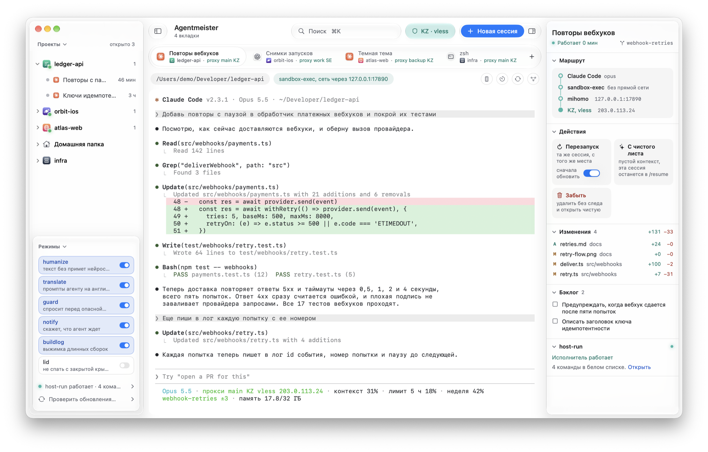
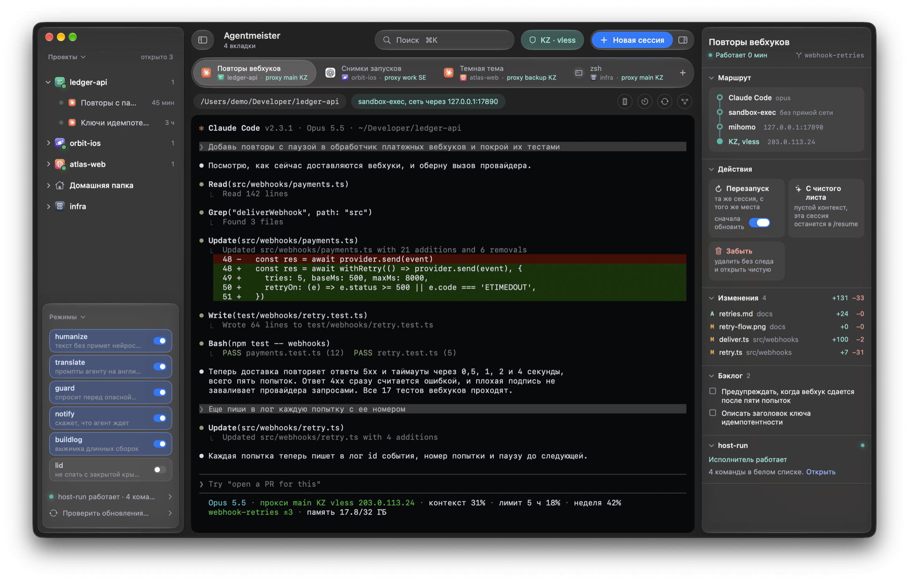
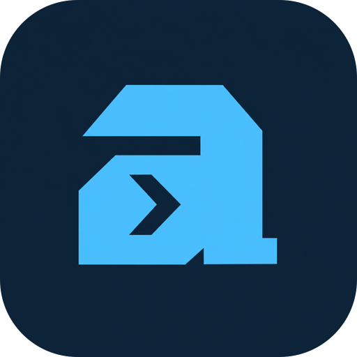

<h1 align="center">
  <picture>
    <source media="(prefers-color-scheme: dark)" srcset="docs/agentmeister-logo-dark.png">
    
  </picture>
</h1>

<p align="center"><a href="README.md">English</a> · Русский</p>

Запуск [Claude Code](https://code.claude.com) и Codex на macOS с выбором проекта и сессии. В обоих агентах
работают правила письма humanize, бэклог и заметки к релизу. Отдельную сессию можно пустить через свой прокси.
В Claude Code также есть перезапуск и сжатие сессии, уведомления и вопросы перед опасными командами.

<p align="center">
  
</p>

Меню говорит на языке macOS, русском или английском. Часть сообщений, например `agentmeister -h` и
`agentmeister proxy -h`, пока только на русском.

```
# Меню для Claude Code и Codex
agentmeister                меню: сессии, переключатели режимов, прокси, установка

# Codex из терминала
agentmeister --harness codex kcalm        выбрать сессию проекта
agentmeister --harness codex install     установить Codex CLI через Homebrew
agentmeister --harness codex setup       установить хуки, навык и MCP
agentmeister --harness codex statusline  вывести снимок promptsill

# Claude Code из терминала
agentmeister --harness claude install    установить Claude Code с сайта Anthropic
agentmeister kcalm          сразу в проекте (достаточно начала имени)
agentmeister root           в домашней папке
agentmeister ... -x         эта сессия через proxy
agentmeister ... -x home    только через подписку home (agentmeister proxy add)
agentmeister ... -i         без истории запросов Claude Code
agentmeister sessions       сохраненные сессии: продолжить, перенести, удалить, поиск, сжатие
agentmeister ps             запущенные сессии и кто ждет ответа; перейти во вкладку
agentmeister restore        вернуть сессии после перезагрузки или сбоя
agentmeister usage          токены и активное время по проектам и моделям
agentmeister headsup        заметки Heads up от Claude Code, и случайно закрытые

# Изнутри Claude Code, они же /restart, /forget, /fresh, /slim
agentmeister restart        закрыть, обновить Claude Code, открыть эту же сессию
agentmeister forget         удалить эту сессию и открыть чистую
agentmeister fresh          новая сессия, эта остается в /resume
agentmeister slim           сжать эту сессию и открыть снова
agentmeister agent-update claude|codex  обновить агента тем способом, каким он установлен

# Режимы: on, off
agentmeister humanize       правила письма для Claude Code и Codex
agentmeister translate      перевод промптов на английский через OpenRouter; key, check
agentmeister guard          вопрос перед чтением ключей и опасными командами
agentmeister buildlog       Claude получает выжимку длинного вывода сборок
agentmeister notify         уведомления, когда Claude ждет; telegram, phone
agentmeister lid            не засыпать с закрытой крышкой; setup, remove

# Прокси для сессий
agentmeister proxy          состояние; setup, add, list, test, update, restart, remove, run
agentmeister host-run <имя>  команда из белого списка вне песочницы proxy

# Инструменты проекта
agentmeister brief          где мы остановились: git, прошлая сессия, бэклог
agentmeister todo           бэклог проекта между сессиями
agentmeister parallel       задача в своем worktree, во втором окне Claude
agentmeister ask            спросить отдельный Claude про другой проект
agentmeister release-notes  материал для "Что нового" к релизу
agentmeister shot [прил.]   снимок окна приложения
agentmeister deps           устаревшие зависимости Gradle

# Установка
agentmeister setup          команды, хуки, MCP-сервер, хук zsh, promptsill
agentmeister doctor         проверить установку
agentmeister projects-dir   папки с проектами; add, remove
agentmeister lang           язык интерфейса: ru, en, auto
agentmeister defaults       режим и Remote Control сессий от agentmeister, обновление при /restart, модель /ask
agentmeister alias          короткое имя am; on, off
```

## Установка

```bash
brew install kopylovis/tap/agentmeister
agentmeister
```

`am` открывает то же меню.

### Десктопное приложение

Скачай `Agentmeister-<версия>.dmg` из [последнего релиза](https://github.com/kopylovis/agentmeister/releases/latest),
открой его и перетащи Agentmeister в "Программы". Приложение подписано Developer ID и нотаризовано. Нужны macOS 26
на Apple Silicon или Intel и Command Line Tools от Xcode (`xcode-select --install`). CLI `agentmeister` и promptsill
лежат внутри приложения. Если приложение запущено из "Программ", оно ставит ссылки `~/.local/bin/agentmeister` и
`~/.local/bin/promptsill` на них, когда этих команд еще нет, так что Homebrew не обязателен. Если в PATH есть CLI
новее или git-копия этого репозитория той же версии, приложение берет его.

Приложение обновляется через Sparkle. Раз в день оно читает `appcast.xml` из последнего релиза на GitHub, скачивает
новую версию и ставит ее при выходе, чтобы не остановить агентов в открытых вкладках. Пункт "Перезапустить и
обновить до <версия>" в меню Agentmeister ставит скачанное обновление сразу и открывает вкладки снова. Если
agentmeister или promptsill стоят из Homebrew, после обновления приложение в фоне запускает для них `brew update` и
`brew upgrade`, чтобы терминал и строка состояния тоже перешли на новую версию. Лог лежит в
`~/Library/Logs/Agentmeister/brew-upgrade.log`. Что умеет
приложение и как его собрать, описано в [app/README.md](app/README.md).

<table>
  <tr>
    <td width="50%"></td>
    <td width="50%"></td>
  </tr>
  <tr>
    <td>Новая сессия: агент, маршрут, подписка proxy и как начать.</td>
    <td>Экран проекта: сессии, инструменты, бэклог, параллельные задачи и последние коммиты.</td>
  </tr>
  <tr>
    <td colspan="2"></td>
  </tr>
  <tr>
    <td colspan="2">Настройки proxy: выход, маршрут и подписка по умолчанию, список подписок. main и backup в KZ
    идут по очереди для просто <code>-x</code>, work в SE только отдельно.</td>
  </tr>
  <tr>
    <td width="50%"></td>
    <td width="50%"></td>
  </tr>
  <tr>
    <td colspan="2">Светлая и темная тема. Приложение следует за macOS или всегда светлое либо темное, это
    Настройки → Основные → Оформление. Терминал меняется вместе с окном. Остальные снимки на этой странице
    идут в теме вашего GitHub.</td>
  </tr>
</table>

На скриншотах выдуманные проекты и данные из демо-режима приложения, он описан в [app/README.md](app/README.md).

### Codex

Если установлены обе CLI, пункт "Открыть проект" предложит выбрать агента. Меню покажет сохраненные сессии
в выбранной папке до запуска Codex. Из терминала можно запустить `agentmeister --harness codex <проект>`.
Если знаешь ID сессии, допиши после проекта `-- resume <id>`.

`agentmeister --harness codex setup` подключает хуки humanize, translate, guard, notify и buildlog, устанавливает навык
`$agentmeister` и регистрирует инструменты MCP для бэклога, заметок к релизу и проверки зависимостей Gradle.

Подтверди новые хуки через `/hooks` в Codex. Команда `agentmeister humanize` показывает состояние режима
и хуков Codex. Команды `agentmeister humanize on` и `off` меняют настройку для обоих агентов. Если режим включен,
Codex получает правила через хуки. После ответа хук `Stop` проверяет текст и передает найденные замечания
в следующий ход.

С `agentmeister notify on` Codex CLI присылает уведомления о запросах разрешения и долгих ответах. Каналы и
порог длительности общие с Claude Code. Если хук определил вкладку терминала, нажатие на уведомление на Mac
может вернуть в нее. `agentmeister doctor` показывает, подтверждены ли хуки уведомлений.

Введи `$agentmeister` в поле ввода Codex или выбери навык в `/skills`. [Навыки Codex](https://learn.chatgpt.com/docs/build-skills)

```text
$agentmeister humanize status
$agentmeister todo list
$agentmeister where
$agentmeister release-notes с v1.13.0
```

Чтобы переоткрыть ту же сессию Codex, выбери "Restart Codex" в `/presets` или введи
`$agentmeister restart`. Затем введи `/quit` по подсказке.
Пункт "Update and restart Codex" после `/quit` запускает `agentmeister agent-update codex` и затем открывает
ту же сессию. `agent-update` обновляет агента тем способом, каким он установлен: из Homebrew через `brew upgrade`
(с `--cask` для cask), после официального установщика, npm и других способов через `claude update` или
`codex update`. Можно также ввести `$agentmeister restart --update`. Из терминала доступна команда
`agentmeister --harness codex restart <id>`. Если Agentmeister определил вкладку и в zsh подключен хук
перезапуска, сессия откроется в той же вкладке.

В Codex `/new` открывает новую сессию, `/delete` спрашивает подтверждение на удаление текущей, а
`/compact` сжимает текущий контекст. Команда `/slim` в Claude Code уменьшает размер файла переписки.

С promptsill 0.8.0 и новее setup также настраивает строку Codex с лимитами и контекстом.
`agentmeister --harness codex setup --remove` убирает установленный навык, хуки и регистрацию MCP.

`agentmeister --harness codex statusline` вызывает `promptsill codex`, если команда есть в установленной версии
promptsill. Результат выводится в терминал. Поля под строкой ввода меняются через `/statusline` в Codex.

### Claude Code

Для настройки Claude Code запусти `agentmeister setup`.

В Claude Code команда `/import-codex` показывает сессии Codex в текущей папке. Выбери сессию или передай ее
UUID. Claude прочитает переписку, план, ветку Git и записанные изменения файлов. Можно также прочитать текущие
инструкции проекта и выбранные заметки памяти Codex. Прочитанный текст попадает в разговор с Claude. После
обновления запусти `agentmeister setup`, чтобы добавить команду.

В терминале список открывает `agentmeister codex-context sessions`, выбранную сессию читает
`agentmeister codex-context read <UUID>`. Для инструкций укажи `instructions`, для списка заметок `memories`,
для чтения заметки `memory <имя>`.

Формула ставит и `am`, короткое имя для `agentmeister`. `am kcalm`, `am ps`, `am proxy` работают так же.
Если `am` нет, его ставит `agentmeister alias on` или пункт "Короткое имя am" в меню. Чужой `am` они не
трогают, `agentmeister alias off` убирает только свой.

Homebrew ставит заодно mihomo для `agentmeister -x`. `agentmeister setup` кладёт команды `/restart`,
`/forget`, `/slim` и другие в `~/.claude/commands` (свою команду с тем же именем не трогает), хуки в `~/.claude/settings.json`, хук zsh в `~/.zshrc`
и регистрирует MCP-сервер `agentmeister`. Если прокси еще не настроен, setup спрашивает, настроить
ли его сейчас (`--country KZ` сразу задает страну выхода). Если нет строки состояния
[promptsill](https://github.com/kopylovis/promptsill), предлагает поставить ее через Homebrew.

Claude Code удаляет переписки старше `cleanupPeriodDays`, по умолчанию через 30 дней, и вместе с ними пропадает
все, что могли найти `session_search` и `/resume`. setup ставит 365, если у тебя нет своего значения.

Какие шаги сделаны, setup записывает в `~/.config/mnrh/claude-setup.json`. Если `agentmeister` запустить
до setup или после обновления, в котором в setup появился новый шаг, он перечислит ненастроенное и предложит
настроить. "Не предлагать" больше не спрашивает про эти шаги, `agentmeister setup` все равно настроит их.

Каждый старт сессии записывается в `~/.cache/mnrh/open/`: папка, вкладка терминала, caffeinate, прокси
и флаги запуска, а обычный выход запись убирает. `agentmeister ps` показывает открытые сессии с состоянием
(ждет тебя, работает, свободна) и переходит во вкладку выбранной в Terminal или iTerm2. После перезагрузки,
обновления macOS или падения `agentmeister restore` открывает сессии, чьи записи остались, каждую в своем
окне с `--resume`, тем же режимом, прокси и флагами. Сессии, запущенные с `-i`, не записываются.

`agentmeister doctor` проверяет все это разом: Claude Code в PATH, команды и совпадают ли они с этой версией,
хуки, срок хранения переписок, строку состояния, ответ MCP-сервера на `tools/list`, хук zsh, приложение
уведомлений, прокси, режим крышки и какие режимы включены. Если в хуках есть интеграция iTerm2 со старым `cc-status`, предупреждает, что с iTerm2 3.7.7
ее стоит переустановить на `it2 handle-agent-hook`. Если что-то сломано, выходит с кодом 1 и пишет, что это
исправит.
В Codex диагностика проверяет версию CLI, ответ MCP, навык `$agentmeister` и поля строки состояния.
Для каждого включенного режима она проверяет доверие к хукам нужных событий. Выключенные режимы видны
отдельно. Проверка крышки находится в разделе Mac.

В Codex guard проверяет команды оболочки и пути файлов в патчах. После подтверждения в чате агент может
повторить команду. Если подтверждения ждут несколько команд, guard укажет текст ответа для каждой.
Buildlog сокращает вывод команд сборки вроде `./gradlew test` и `cd app && make test`, сохраняя код завершения.
Интерактивные запуски, конвейеры и перенаправление вывода работают как обычно.

Обновление: `brew upgrade agentmeister`. Открытые сессии подхватят новую версию сами: перед каждым
запросом MCP-сервер проверяет, не сменился ли его код (`brew upgrade` или `git pull` в папке проекта), и если
сменился, заменяет себя новым на том же соединении, не теряя запрос. Убрать из Claude Code: `agentmeister setup --remove`.
Удаление: `brew uninstall agentmeister`.

Проекты лежат в папках с проектами, по умолчанию это `~/Developer`, проектом считается каждая подпапка.
Еще одну папку добавляет `agentmeister projects-dir add <папка>`, убирает `remove`, список показывает `projects-dir`.
Он же хранится в `~/.config/mnrh/config` строкой `projects=<папка>[:<папка>...]`, `MNRH_PROJECTS` его перекрывает.
Одноименные проекты из разных папок видны оба, с папкой в имени, например `backend · Work`. Десктопное
приложение спрашивает папки при первом запуске. Читающие MCP-инструменты (`session_search`, `session_read`, `usage_report`,
`deps_outdated` и другие) setup разрешает сразу в `permissions.allow` в `~/.claude/settings.json`.

### Из исходников, для разработки

```bash
git clone https://github.com/kopylovis/agentmeister ~/Developer/agentmeister
cd ~/Developer/agentmeister
make install
agentmeister setup
```

`make install` кладёт в `~/.local/bin` символическую ссылку на проект, поэтому правки работают без
переустановки. Рядом появляется `am`, если `~/.local/bin/am` не занят другой программой. Для удаления есть `make uninstall`, для проверки `make test`.

### Выпуск новой версии

1. Поднять номер в `VERSION`, через PR.
2. Поставить подписанный тег на коммит в `main`: `git tag -s v$(cat VERSION) -m v$(cat VERSION)` и запушить его.
3. В `kopylovis/homebrew-tap` в `Formula/agentmeister.rb` обновить `tag:` и `revision:`
   (`git rev-parse v$(cat VERSION)^{commit}`).
4. Запустить `make dmg` из обычного терминала, не из сессии через proxy. `app/release.sh` собирает приложение для
   Apple Silicon и Intel, подписывает его Developer ID, нотаризует приложение и DMG и кладет
   `app/build/release/Agentmeister-<версия>.dmg`, а рядом `appcast.xml`. Оба файла нужно приложить к релизу этого
   тега на GitHub. Установленные приложения находят обновление по `appcast.xml` последнего релиза.

## Требования

macOS, bash и `/usr/bin/python3` из Xcode Command Line Tools (`xcode-select --install`). Для уведомлений
нужен `swiftc` оттуда же, для `agentmeister -x` нужен mihomo.

## Как работает `agentmeister`

`agentmeister` без аргументов в терминале открывает меню действий. В разделе "Агенты" собраны статус и настройка
Claude Code и Codex. В терминале `agentmeister --harness claude status` показывает версию и открытые сессии,
а `agentmeister --harness codex statusline` выводит сохраненные лимиты и контекст через promptsill.
Выбранное запускается, а полная команда печатается, чтобы в следующий раз набрать ее сразу. После действия
можно вернуться в меню. Режимы humanize, guard, buildlog, уведомления и крышка показаны как `[вкл]` или
`[выкл]`, и Enter переключает их на месте, меню остается открытым. Меню занимает весь экран: слева список,
справа описание выбранного пункта, команда, которая сделает то же самое, и текущее состояние (версии,
включенные режимы, прокси). Tab прячет описание, в узком окне оно скрывается само. В iTerm2 и WezTerm у пунктов свои иконки, в Terminal.app и
остальных терминалах emoji. Строка `icons=emoji` или `icons=images` в `~/.config/mnrh/config` (или `MNRH_ICONS`)
выбирает явно. iTerm2 3.7 при первом показе спросит, разрешить ли картинки, нужно ответить Yes и отметить
"Remember my choice". Иконки рисует `tools/icons.py`, готовые PNG лежат в `share/agentmeister/icons`. Так же выглядят подменю. У проекта справа видны
ветка и три последних коммита, у сессии последние сообщения, у режима сессии и сети пояснение к варианту.
Подменю открываются на том же экране. Команды из меню тоже выполняются в рамке: вывод с цветами, их
собственные списки и вопросы на том же экране, после конца Enter возвращает в меню, а `q` выходит и оставляет
вывод в обычном терминале. Снаружи запускается только сам Claude Code. Esc возвращает на шаг
назад, Ctrl+C выходит совсем. `MNRH_PLAIN_MENU=1`
возвращает простые списки в строку. Меню говорит на языке macOS, русском или английском. Строка `lang=en` или
`lang=ru` в `~/.config/mnrh/config` выбирает язык явно. `agentmeister lang en` или `ru` записывает эту строку,
а `lang auto` убирает. `MNRH_NO_MENU=1` пропускает меню и сразу открывает
выбор проекта.
`agentmeister open` показывает каталоги папки проектов (по умолчанию `~/Developer`, другую задает строка `projects=<путь>` в `~/.config/mnrh/config` или `MNRH_PROJECTS`) с текущей веткой и датой последнего коммита.
Выбор стрелками ↑↓ и Enter. Цифра сразу ставит курсор на пункт (`0` — домашний
каталог, `1` и `0` подряд — десятый), буквы фильтруют список по имени, Esc
сбрасывает фильтр или выходит.

Сессии, которые открывают `open_claude`, `/parallel` и меню, стартуют без caffeinate и без Remote Control, пока
это не поменять: `agentmeister defaults mode caffeinate`, `agentmeister defaults remote-control on`.
`agentmeister defaults restart-update off` отключает `claude update` при `/restart` (`agentmeister restart
--update` все равно обновит), `agentmeister defaults ask-model opus` выбирает модель для `/ask`.

Если у проекта есть сохранённые сессии, дальше предлагается продолжить одну из них или
начать новую (Enter — новая). Сессии свежие сверху: когда, размер, число сообщений и
название. Пустые (только `/clear` и т. п.) не показываются, открытые в других окнах тоже,
чтобы две копии Claude не писали в один файл. Шага нет с `--new` и когда после `--` уже
есть `--continue`, `--resume`, `--session-id` или `--print`; `open_claude` передаёт `--new`.

Затем так же выбирается режим:

- **caffeinate** (Enter) — `caffeinate -is`: Mac не засыпает ни от простоя, ни на
  питании от сети, пока идёт сессия. Экран гаснуть может. Нужно для долгих задач
  и для Remote Control с телефона — уснувший Mac обрывает сессию.
- **обычная** — просто `claude`.

`-k` и `-n` выбирают режим без вопроса, всё после `--` передаётся claude:
`agentmeister kcalm -k -- --continue`. Закрытую крышку на батарее caffeinate не
перебивает: Mac с закрытой крышкой без зарядки все равно уснет.

Это обходит `agentmeister lid setup`. Он спрашивает пароль sudo и ставит
`/etc/sudoers.d/mnrh-pmset`, правило без пароля ровно на `pmset -a disablesleep 1` и
`pmset -a disablesleep 0`. Дальше каждая caffeinate-сессия запускает сторожа. Он включает
`disablesleep`, пока жива хоть одна такая сессия, и снимает его через две минуты после
последней, этого хватает на перезапуск с `claude update`. Еще он снимает запрет, когда батарея садится до
15%, и присылает уведомление. В закрытой сумке Mac греется, так что следи за этим сам.
`agentmeister lid` показывает, держит ли сторож крышку сейчас. `off` выключает режим, правило при этом
остается, и `on` возвращает режим без пароля. `release` отпускает крышку до следующей caffeinate-сессии,
`remove` выключает режим и убирает правило. Журнал сторожа лежит в `~/.local/state/mnrh/lid.log`. Правило и
сторож общие с `mnrh sleep lid`: если ты настроил его в mnrh, agentmeister подхватит его сам.

### Сеть сессии

Для Claude Code выбери "через proxy" в меню "Сеть" или запусти `agentmeister <проект> -x`.
Claude отправляет запросы к API Anthropic через локальный mihomo. Это работает и вне домашней сети,
если сервер из подписки доступен. При обрыве запросы завершаются ошибкой. macOS блокирует прямые
соединения с внешними портами 80 и 443, включая HTTPS по TCP и QUIC по UDP. Через mihomo ходят
и другие HTTPS-клиенты сессии, например `gh`. SSH на обычном порту, локальные серверы и Unix-сокеты
доступны. Браузер, в котором открывается страница входа, использует свои сетевые настройки.

В Codex с флагом `-x` и в `agentmeister proxy run [--via <имя>] -- <команда>` действует строгий режим.
Для сети доступен только локальный TCP-порт mihomo. Git может подписывать коммиты через сокет
`SSH_AUTH_SOCK`, если он принадлежит текущему пользователю. В обоих режимах команда со своей
песочницей macOS может завершиться с ошибкой `sandbox_apply: Operation not permitted`.

Ограничение действует с запуска. Чтобы применить его к открытой сессии, выйди и продолжи ее через proxy.
У других приложений на Mac свои сетевые настройки. `-d` запускает сессию напрямую.

Команды, которым песочница мешает, Claude запускает через `agentmeister host-run <имя> [аргументы]`.
Так работают xcodebuild с пакетами Swift и firebase-tools. Исполнитель поднимается вместе с сессией
через proxy, пока песочницы еще нет, и выполняет только команды из `~/.config/mnrh/host-run/commands.json`.
Команда идет как в обычном терминале, с прямой сетью. Вывод и код выхода возвращаются в сессию,
а Ctrl+C ее останавливает. Писать в список сессия через proxy не может, но может попросить:

```sh
agentmeister host-run add myapp-beta --cwd ~/Developer/myapp --run bundle exec fastlane ios_beta
agentmeister host-run remove myapp-beta
```

Исполнитель показывает на маке окно с именем, папкой и полной командой. Запись появится, только если
нажать "Разрешить" мышью или трекпадом. Клавиатурой, синтетическим кликом из сессии или через
Универсальный доступ эту кнопку не нажать, а окно собирается из Swift в папке исполнителя, куда сессия
писать не может (при первом запросе нужен `swiftc`). Отказ, закрытое окно или две минуты без ответа
дают ошибку с кодом 1, и файл не меняется. Занятое имя без `--replace` не перезаписывается, с ним в окне
видно старую и новую команду. `--args` разрешает сессии дописывать аргументы. Исполнитель записывает
файл целиком через временный файл и сохраняет остальные записи. Список можно вести и руками в обычном
терминале:

```json
{
  "commands": {
    "myapp-beta": {"cwd": "~/Developer/myapp", "run": ["bundle", "exec", "fastlane", "ios_beta"]},
    "myapp-firebase": {"cwd": "~/Developer/myapp", "run": ["bundle", "exec", "fastlane", "upload"],
                          "args": true}
  }
}
```

`"args": true` разрешает дописывать аргументы в конец команды. `agentmeister host-run list` показывает
список, `status` проверяет исполнитель. Список бережет от случайного прямого трафика, но не от правок
в самом проекте: команда выполнит тот Fastfile или скрипт, который лежит в папке.

Папки над списком и сокетом сессия тоже не может переименовать или заменить ссылкой, а исполнитель
читает список, только если файл твой, писать в него никто другой не может и на пути к нему нет твоих
символических ссылок. Если `~/.config` у тебя ссылка, укажи настоящую папку в `XDG_CONFIG_HOME`.

Песочница ограничивает сеть и защищает служебные файлы agentmeister. Среди них настройка и подписка
mihomo в `~/.config/mnrh/proxy/` и его сокет управления: через сокет mihomo загрузил бы любой конфиг.
В `~/.local/state/mnrh/proxy/` (записи об идущих сессиях, pid mihomo, журнал сторожа) сессия тоже ничего
не меняет и не делает жестких ссылок на файлы из этих папок, а замок там не может даже открыть. Запись о
сессии лаунчер делает под своим pid еще до песочницы. Поэтому внутри сессии через proxy `agentmeister proxy`
показывает сервер, выбранный при запуске mihomo, а не текущий, `agentmeister proxy test` и вложенный
`agentmeister proxy run` работают через mihomo, который уже держит эта сессия (вложенная команда остается
в песочнице сессии, вложенную песочницу macOS не дает), а `restart`, `setup` и `remove` просят выполнить
их в обычном терминале. Границей для кода
песочница не служит:
сессия через proxy по-прежнему может писать `~/.zshrc`, хуки git, настройки Claude и другие файлы,
которые потом выполнятся вне ее.

Работает через [mihomo](https://wiki.metacubex.one) (`brew install mihomo`). Он умеет
VLESS (в том числе XHTTP) и Hysteria2 и берет из подписки первый живой сервер. Настройка один раз:

```bash
agentmeister proxy setup 'https://…/sub/…' --country DE   # ссылка на подписку для Clash, mihomo или v2ray
agentmeister proxy test                                    # выход напрямую и через сервер: IP и страна
```

`--country` защищает аккаунт: если сервер выведет не в ту страну, сессия через прокси не
запустится, а не пойдет из неожиданного места. Когда сторож сети или `agentmeister proxy restart`
перезапускает mihomo при идущих сессиях, не та страна только сообщается (сторож пишет об этом в
`~/.local/state/mnrh/proxy/watch.log`), а mihomo продолжает работать, и сессии не теряют сеть.
`--only <выражение>` оставляет из подписки
только серверы с подходящим именем. Зашифрованные ссылки `happ://crypt…` читает только Happ,
нужна обычная `https://`.

Страну выхода agentmeister проверяет через `https://1.1.1.1/cdn-cgi/trace`, а mihomo проверяет серверы через
`https://www.gstatic.com/generate_204`. Если в сети они закрыты, их заменяют `agentmeister proxy check-url <адрес>`
(любой `/cdn-cgi/trace` Cloudflare) и `agentmeister proxy probe-url <адрес>` (отвечает 204 или 200), второй
начинает работать после `agentmeister proxy restart`.

Кроме основной подписки можно добавить еще. У каждой свое имя и свой порт:

```bash
agentmeister proxy add home 'https://…/sub/…' --country KZ   # --country и --only как у setup
agentmeister proxy list                                       # имена, порты и флаги -x
agentmeister kcalm -x home                                    # только через home, без перехода на другие
agentmeister kcalm -x                                         # через все по очереди
```

Просто `-x` идет по подпискам по очереди. Сначала основная, а следующая берется, только когда у
прошлой не отвечает ни один сервер. Если у основной задан `--country`, в очередь попадают только
подписки с той же страной, и сессия посреди работы не уйдет в другую страну. Остальные доступны
только через `-x <имя>`. `-x main` идет только через основную. У Codex те же флаги. Перезапуск,
`/fresh`, `agentmeister restore` и новые окна из сессии сохраняют ее подписку.
`agentmeister proxy remove home` удаляет одну подписку, а просто `agentmeister proxy remove` всю
настройку. Когда подписку добавляют или удаляют, mihomo перезапускается, а сессии через другие
подписки продолжают работать. Если проект называется так же, как подписка, пиши проект до `-x`. Имя
подписки состоит из строчных латинских букв, цифр и дефиса, до 20 знаков, и начинается с буквы. Имена `main`,
`vps`, `direct`, `reject` и `all` заняты. `proxy add` с уже существующим именем заменяет ссылку и настройки этой
подписки. С `--country` команда проверяет выход и ничего не сохраняет, если он в другой стране. `proxy setup`
отказывается, пока идут сессии через proxy.

Страна выхода проверяется при каждом запуске через proxy, а не только когда стартует mihomo. Сессия,
которая вышла бы не из той страны, не запустится. Для просто `-x` проверяется выход каскада и каждая
подписка очереди со своим портом. Сессия Claude Code достает только до своего порта mihomo. Песочница
закрывает порты других подписок и весь диапазон 17890-17939, из которого mihomo берет порты, поэтому
локальные серверы на этих портах из сессий Claude Code через proxy недоступны. Если подписки больше
нет (ее удалили или в `--proxy=` опечатка), запуск останавливается, а не уходит в каскад. Пока идут
сессии только через `main`, а своего порта у нее еще нет, `proxy add` отказывается и просит сначала их закрыть.
Ссылки на подписки и скачанные списки серверов сессиям не видны, а curl получает ссылку через stdin,
поэтому ее нет в `ps`. Слушать порты mihomo сессия Claude Code тоже не может, то есть не займет порт,
пока mihomo перезапускается, а запуск проверяет, что нужные ему порты слушает именно mihomo. Страницы,
которые открывает агент, и ссылки, по которым кликают во вкладке, идут через подписку этой вкладки,
у каждой подписки свое окно браузера и свой профиль Chrome.

Сторож сети держит страну выхода и во время сессии. Каждые 2 секунды он смотрит, какой сервер mihomo
выбрал для подписок, через которые идут сессии. Когда mihomo переходит на другой сервер (внутри той же
подписки или на следующую в очереди), сторож сразу закрывает подписку, проверяет страну нового сервера
через отдельный порт проверки, недоступный сессиям, и открывает подписку, только если страна та. Иначе он
закрепляет живой сервер нужной страны из той же подписки, а если такого нет, оставляет подписку закрытой.
Запросы тогда отклоняются, как при упавших серверах, а сторож ищет снова раз в 5 минут. Закрытую подписку
видно в `agentmeister proxy`, подписью "закрыто" под вкладкой и предупреждением в приложении, а новые сессии
через нее не запускаются. Запросы,
отправленные за те до 2 секунд, пока сторож не заметил переключение, все же уходят через новый сервер.
`--only` с именами серверов нужной страны убирает такие переключения совсем.

`agentmeister proxy` показывает версию mihomo и, если в Homebrew есть новее, подсказывает
`agentmeister proxy update`. Эта команда делает `brew upgrade mihomo`. Если mihomo запущен, а сессий
через proxy нет, она останавливает его, и новая версия поднимется с первой сессией. Если сессии идут,
она спрашивает, перезапустить ли mihomo сейчас. Запросы, которые идут в эту секунду, при этом
оборвутся, Claude Code их повторит. Без перезапуска новая версия заработает после последней сессии.

Пока mihomo запущен, рядом работает сторож сети. Раз в 2 секунды он смотрит на маршрут по умолчанию
и на группу каждой подписки, через которую идут сессии. Если сеть вернулась через другой интерфейс (Wi-Fi
вместо Ethernet, хотспот), он прописывает новый интерфейс и перезагружает конфиг mihomo. Подписку, у которой
не осталось живых серверов, он сразу просит mihomo перепроверить, а не ждать плановой проверки раз в пять минут.
Когда при живой сети ни у одной подписки с сессиями 30 секунд нет живого сервера, сторож перезапускает mihomo,
но не чаще раза в пять минут. Упавший mihomo сторож поднимает снова, пока идут сессии через proxy, но не чаще
раза в 30 секунд. Журнал сторожа лежит в
`~/.local/state/mnrh/proxy/watch.log`. `agentmeister proxy restart` перезапускает mihomo руками, сессии через
proxy при этом остаются открытыми.

mihomo слушает `127.0.0.1:17890` (или следующий свободный порт, если при setup 17890 был занят), стартует
с первой сессией через сервер и останавливается после последней. Каждая добавленная подписка получает свой
порт из того же диапазона 17890-17939. Сессия получает `HTTPS_PROXY`, `HTTP_PROXY` и `ALL_PROXY` с адресом
своего порта. `/restart` и окна, которые открывают `open_claude` и `/parallel` из такой сессии,
тоже идут через сервер.

К серверу mihomo ходит через Wi-Fi или Ethernet в обход TUN-туннеля Happ и других VPN, так
что Happ можно включать и выключать во время сессии, сессия этого не заметит. Это важно,
когда Happ подключен к тому же серверу: через его туннель сервер сам до себя не достучится.
Подписку agentmeister скачивает тем же путем при каждом запуске mihomo; если не вышло, берет прошлую
копию. Ответ, в котором нет ни одного сервера (страница входа в Wi-Fi, ошибка с кодом 200), прошлую
копию не заменяет. Если живых серверов в подписке нет, соединения отклоняются, а не уходят напрямую.
Адреса серверов из подписки agentmeister узнает через DNS системы и записывает в `hosts` конфига mihomo.
Сам mihomo в DNS не ходит. Иначе при корпоративном VPN, где DNS-сервер доступен только через
туннель, его запрос через Wi-Fi не доходит, и mihomo не узнает адрес сервера.
Настройка, ссылка и подписка лежат в `~/.config/mnrh/proxy/` с доступом только для тебя.
Страну выхода agentmeister проверяет при каждом запуске mihomo и передает сессии в
`PROMPTSILL_PROXY_LABEL`, по ней promptsill пишет в строке состояния `proxy KZ`. Еще agentmeister
спрашивает у mihomo через unix-сокет `~/.local/state/mnrh/proxy/mihomo.sock`, какой сервер
из подписки выбран и по какому протоколу, и передает протокол с IP в `PROMPTSILL_PROXY_DETAIL`.
В macOS Terminal строка выглядит как `proxy KZ vless 203.0.113.7`. В iTerm2, Ghostty и других
терминалах со ссылками остается `proxy KZ`, а Cmd-клик открывает страницу с подробностями
(`exit.html` в той же папке). Когда подписок больше одной, сессия только через одну из них показывает
и ее имя, `proxy home KZ`, а сессия с просто `-x` показывает подписку рядом с протоколом и IP. Эти
переменные задаются при запуске сессии. Еще сессия получает `PROMPTSILL_PROXY_FILE`, файл выхода своей
подписки в той же папке, а сторож переписывает его при каждой смене сервера. promptsill, который читает этот
файл, берет подпись из него, поэтому сессия с просто `-x` показывает подписку, через которую идет сейчас
(`proxy backup KZ`), а закрытая подписка видна как закрытая. Текущий сервер показывает и `agentmeister proxy`.
Если mihomo
нет, `setup` предложит поставить его через brew; формула agentmeister ставит его сама.

## Как работает `agentmeister sessions`

Claude Code хранит сессии в `~/.claude/projects/<путь-папки>/<id>.jsonl`, рядом папка
`<id>/` с субагентами и большими выводами инструментов. `claude --resume` видит только
сессии текущей папки, поэтому после переезда проекта старые сессии пропадают из списка.

Без аргументов — список всех сессий, свежие сверху: когда, размер, папка, название
(своё из `/rename`, иначе придуманное Claude, иначе последний запрос). `● открыта` —
сессия идёт в другом окне, её не трогаем. Выбрал стрелками — дальше продолжить
(caffeinate или обычная), перенести или удалить.

- `mv <id> <папка>` — переносит файлы в хранилище новой папки и переписывает `cwd`
  внутри сессии, в том числе у субагентов. Остальное в файле не меняется, дата тоже.
- `rm <id>...` — удаляет сессию вместе с её `file-history` и строками в `history.jsonl`.
- `clean` — битые симлинки, сессии, где Claude так ни разу и не ответил, и папки
  проектов, которых больше нет на диске (вместе с их `memory`). Каждая группа
  спрашивается отдельно.
- `resume <id> [-n]` продолжает сессию в ее папке (через caffeinate, с `-n` обычной).
- `rename <id> <название>` переименовывает ее, как `/rename` в Claude Code.
- `-l` — просто список с id, без меню.
- `search <слова>` — поиск по всем сессиям всех проектов (подробно ниже), `show <id> [N]` —
  прочитать сессию с сообщения `N`, `-10` — последние десять.

## Сжатие старых сессий: `agentmeister sessions slim`

Большая сессия почти целиком состоит из скриншотов и выводов инструментов: у authmeister
из 481 МБ ~330 МБ занимают картинки (каждая хранится дважды — для модели и копия для
экрана), а текст разговора — несколько мегабайт. После `/compact` Claude Code отправляет
модели только сводку, сообщения, которые `/compact` сохранил (`preservedMessages`), и то,
что было после границы: при продолжении сессии он идёт от последнего сообщения назад и
останавливается на `compact_boundary`. Старая часть нужна только для прокрутки вверх, но
`--resume` всё равно разбирает весь файл — отсюда медленное открытие и память.

`slim` в части до двух последних `/compact` (`--keep N`) заменяет скриншоты подписью
`[скриншот 1,2 МБ удалён: mnrh slim]` (в копии для экрана — картинкой 1×1, чтобы экран не
ломался) и обрезает выводы длиннее 8000 символов до начала и конца. Не трогает: всё после
этой границы, сообщения, сохранённые при `/compact`, цепочку до последнего сообщения,
сообщения Claude (в них подписи блоков размышлений) и историю файлов для `/rewind`.

Сжимается и папка рядом с файлом сессии (`<id>/`). Сохраненные выводы и скриншоты в `tool-results`,
о которых в контексте модели нет ни слова, уходят в резервную копию, а переписки субагентов, которых
модель уже не видит, сжимаются так же, как старая часть. Сам контекст `slim` не уменьшает. Если в нем
больше 200 тысяч токенов, `/slim` советует `/compact`.

Перед записью сжатый файл сверяется с оригиналом: число строк, `uuid`, `parentUuid`,
типы и время совпадают, всё, что попадает в контекст модели, совпадает побайтно, иначе
ничего не записывается. Оригинал сжимается в `~/.cache/mnrh/slim-backup/` и хранится
14 дней; `slim <id> --undo` возвращает его вместе с сообщениями, дописанными после
сжатия. Дата сессии не меняется. Открытые сессии не сжимаются.

```
agentmeister sessions slim              что можно освободить по всем закрытым сессиям
agentmeister sessions slim <id> --copy  сжатая копия с новым id — открыть и проверить
agentmeister sessions slim <id>         сжать (спросит подтверждение, -y без вопроса)
agentmeister sessions slim <id> --undo  вернуть оригинал
```

Изнутри Claude Code — `/slim` (или попросить «сожми эту сессию», инструмент `slim` в MCP).
Открытую сессию сжимать нельзя, поэтому `/slim` работает как `/restart`: сначала считает,
сколько освободится, и если меньше 5 МБ — ничего не закрывает и просто говорит об этом.
Иначе Claude закрывается, во вкладке выполняется `agentmeister sessions slim <id> -y`,
и сессия открывается снова с теми же флагами и caffeinate. После открытия Claude
показывает, сколько было и стало, или почему сжать не вышло (тогда сессия открыта как
была). `/slim list` — что можно сжать среди закрытых сессий, `/slim <id>` — сжать одну из них.

Чего не будет после сжатия: старых скриншотов при прокрутке вверх, а при `/rewind` в
точку до этих двух `/compact` — картинок и полных длинных выводов в том старом разговоре.

## Поиск по прошлым сессиям

Тот же поиск доступен Claude как MCP-инструменты `session_search` и `session_read`: можно
спросить «как мы в sightra настраивали подпись для RuStore?», и Claude сам найдёт это в
прошлых сессиях и прочитает нужное место. Ищется текст запросов, ответов Claude, выполненные
команды (`$ …`, для остальных инструментов — файл или шаблон), ошибки этих команд и сводки
после `/compact`. Обычный вывод инструментов и служебные сообщения не индексируются. От длинной
ошибки берутся первые 600 и последние 900 символов, а отказы самого Claude Code (нет
разрешения, «сначала прочитай файл») пропускаются. `roles=["error"]` (в терминале
`agentmeister sessions search -r error <слова>`) ищет только по ошибкам: так находится, как
уже чинили такую же ошибку. Все слова должны встретиться в
одном сообщении (если такого нет, показываются сообщения хотя бы с половиной слов). Регистр и
форма слова не важны: слова сводятся к основе (для русского стеммер Snowball, для английского
первые шаги Porter), так что `сессия` найдёт `сессии`, а `signing` — `signed`. Дефис делит
слова, а слова через дефис и фраза в кавычках ищутся подряд: `прокси-соединение` найдёт
`прокси-соединения`. Обрубок, который сам уже основа, от 3 букв находит и слова длиннее
(`fastl` найдёт `fastlane`). Служебные слова вроде `как`, `мы`, `the` не учитываются.
Результаты ранжируются по BM25 по сообщениям: сверху сессии с самыми подходящими сообщениями,
свежие чуть выше, а внутри сессии сначала лучшие куски. Текущая сессия в поиск не попадает.

Индекс лежит в `~/.cache/mnrh/sessions-index/`: в `<id>.json` только текст (у самой большой
сессии из 481 МБ около 1 МБ), в `<id>.terms.json` основы слов каждого сообщения (около 40% от
текста). Первый проход по всем сессиям занимает несколько секунд (4 с на 700 МБ переписок),
дальше дочитываются только новые строки, и запрос выполняется быстрее 0,1 с.
Индекс обновляется в фоне при старте каждой сессии (хук `SessionStart`). У удалённых сессий,
в том числе через `/forget` и `sessions rm`, индекс удаляется сразу.

## Расход: `agentmeister usage`

`agentmeister usage [--days N] [--project P] [--top N]` показывает, сколько ушло на Claude Code за последние
N дней (по умолчанию 7, считая сегодня; `--days 0` — за всё время): по проектам число сессий, активное время,
запросы к модели и токены по видам (вход без кэша, выход, чтение кэша, запись в кэш); по моделям то же без
времени; и самые тяжёлые сессии по сумме токенов с названиями. Токены берутся из поля `usage` у ответов
модели в переписках, один раз на ответ, даже если он занимает несколько строк, вместе с субагентами.
Активное время — сумма промежутков меньше 5 минут между событиями переписки, вместе со временем
субагентов, так что долгий перерыв или ночь с открытой сессией не считаются. Денег в отчёте нет: на
подписке важны токены и время. Claude получает тот же отчёт через MCP-инструмент `usage_report`
(«сколько токенов ушло на kcalm за неделю?»).

Итоги по дням лежат в `~/.cache/mnrh/usage/<id>.json` (260 КБ на 700 МБ переписок) и, как индекс
поиска, дочитываются только по новым строкам. Первый проход по всем сессиям занимает около 3 с,
следующие — 0,05 с, а ещё кэш обновляется в фоне при старте сессии. Переписанная сессия (`slim`)
считается заново, у удалённой кэш удаляется.

## Устаревшие зависимости: `agentmeister deps`

Разбирает `gradle/libs.versions.toml` (версии, библиотеки, плагины), сверяет с Google Maven,
Maven Central и Gradle Plugin Portal и показывает, что обновилось, насколько (мажорная,
минорная, патч) и какие библиотеки на этой версии. Ещё — версию Gradle wrapper и что
обновлять вместе: Kotlin и KSP, AGP и Gradle, Compose Multiplatform и Kotlin. Варианты
вроде `-jre`/`-android` сравниваются только между собой, alpha/beta/rc — с `--pre`.
`agentmeister deps status` (и `agentmeister deps` без терминала) — текущий проект, а если в нём нет каталога, все проекты. Ответы
репозиториев кешируются на 6 часов. Для Claude то же самое — инструмент `deps_outdated`.

## Команды в Claude Code

`agentmeister setup` кладёт в `~/.claude/commands/`:

| Команда | Что делает |
|---|---|
| `/restart` | перезапуск с обновлением Claude Code, сессия продолжается |
| `/forget` | удалить эту сессию без следа и открыть чистую |
| `/fresh` | новая сессия без названия и с пустым контекстом, эта остаётся в `/resume` |
| `/slim` | сжать эту сессию и открыть её снова; `/slim list` — другие |
| `/where` | где остановились: git, прошлая сессия в проекте, бэклог, что дальше |
| `/todo` | бэклог: `/todo` — список, `/todo <текст>` — добавить, `/todo done 2` — сделано |
| `/release-notes` | «Что нового» для fastlane на языках проекта |
| `/parallel <задача>` | та же задача в отдельной ветке во втором окне; `--fork` — с этой перепиской; `/parallel list` |
| `/shot <приложение> [вопрос]` | снимок окна, Claude смотрит на него и отвечает |
| `/ask <проект> <вопрос>` | ответ из другого проекта от отдельного Claude |
| `/humanize` | переключить правила письма; `on`, `off`, `status` |
| `/translate` | переключить перевод промптов на английский; `on`, `off`, `status` |
| `/import-codex` | перенести контекст сохраненной сессии Codex в этот разговор |

## Правила письма: `agentmeister humanize`

По умолчанию выключено. С `agentmeister humanize on` (или `/humanize`) хук `SessionStart` передает Claude
правила письма из `share/agentmeister/humanize.md` в начале сессии и после `/compact`, `UserPromptSubmit`
напоминает о них к каждому сообщению, а хук `Stop` проверяет ответ и передает найденное в следующий ход.
Та же настройка включает правила и для Codex (см. выше). `agentmeister humanize rules` показывает правила,
`humanize check <файл>` (`-` читает stdin) находит явные признаки нейросети в тексте, а `humanize log`
показывает результаты проверки ответов. `agentmeister humanize typography on` добавляет раздел строгой
типографики (только прямые кавычки, без буквы е с точками, без двоеточий посреди фразы) из
`share/agentmeister/humanize-typography.md`, и проверка начинает ловить и это. По умолчанию выключено, тот же
переключатель есть в Настройках, Режимы, humanize.

## Перевод промптов: `agentmeister translate`

По умолчанию выключено. С `agentmeister translate on` (или `/translate`, или переключателем в приложении) хук
`UserPromptSubmit` отправляет твое сообщение в OpenRouter (по умолчанию `google/gemini-3.1-flash-lite`, другую
модель задает `translate model <id>`) и добавляет английский перевод рядом с оригиналом. Агент работает по
переводу, при расхождении верит оригиналу и отвечает на твоем языке. Ключ сохраняет `agentmeister translate key`
(`--clipboard` берет его из буфера обмена), он ложится в `~/.config/mnrh` с правами 600, провайдер выбирается
по виду ключа.

Работает и Google AI Studio (`translate provider google`, модель `gemini-3.1-flash-lite`). Он бесплатен
в пределах лимитов, но на бесплатном уровне Google может брать запросы для улучшения моделей, там, где Gemini API
недоступен (например, в России), отвечает только через proxy и временами думает 7-15 секунд. Если сохранен и ключ OpenRouter, Google дается
4 секунды, а опоздает, переведет OpenRouter.

С Mac уходят только сообщения с нелатинскими буквами. Слэш-команды, текст длиннее 4000 знаков и все, что похоже
на секрет (ключи API, токены, приватные ключи, JWT, ссылки на подписки proxy, адреса с паролем или токеном),
не отправляются. В журнале `~/Library/Logs/mnrh-translate.log` остаются время, длина и итог, текста там нет.
`translate check [текст]` переводит пример и показывает задержку. Идея взята из
[translate-hooks](https://github.com/AndrewK404/translate-hooks).

Хук не умеет заменить сообщение, поэтому агент видит и оригинал, и перевод, и токенов уходит немного больше.
Чтобы ушел только английский, в приложении Agentmeister нажми ⌘⇧T во вкладке Claude Code или Codex (клавиша
меняется в настройках). Строка ввода переведется на месте: агент через Ctrl+G отдает ее в `EDITOR` (Codex
через свою клавишу `open_external_editor`, если это ctrl с буквой), а для вкладок
приложения это `libexec/agentmeister/editor/agentmeister`. Пока идет перевод, вкладка показывает снимок экрана
с карточкой, Esc отменяет. Картинки `[Image #N]` остаются, в конце добавляется просьба отвечать на твоем
языке. Перевод можно проверить и нажать Enter, хук его уже не трогает. Обычный Ctrl+G открывает твой
редактор, как раньше. Если ключа переводчика еще нет, ⌘⇧T покажет во вкладке поле для него, провайдер
определится по виду ключа. В настройках сам хук теперь называется "Добавлять перевод к сообщениям без ⌘⇧T". Поле первого запроса на
экране проекта и в листах новой сессии и параллельной задачи переводит кнопка "Перевести" справа сверху
или та же ⌘⇧T.

## Где мы остановились

При старте новой сессии хук `SessionStart` передаёт Claude справку о проекте (как фон, в
разговор не пересказывается): ветка, незакоммиченное и незапушенное, последний тег, пять
последних коммитов, прошлая сессия в этой папке — название, последний запрос и последний
ответ Claude (обычно там итог работы) — и открытые задачи бэклога. Тебе показывается одна
строка: «agentmeister: прошлая сессия «…» (вчера) · незакоммичено 3 · в бэклоге 2 · /where —
подробнее». Только для новых сессий в терминале: не после `--resume`, `/clear`, `/forget`
и не в `claude -p`. Выключить: `agentmeister brief off`.

## Бэклог: `agentmeister todo`

Задачи «на потом», которые живут между сессиями, в отличие от списка задач внутри одной
сессии. По одному файлу на проект: `~/.config/mnrh/todo/<проект>.md`, обычный чек-лист.
Проект — корень git текущей папки, `-p <проект>` — другой. Claude видит открытые задачи
при старте сессии и может сам добавлять («запиши на потом…») и закрывать их
(`todo_add`, `todo_done`, `todo_list` — без вопроса о разрешении).

## Заметки к релизу

`/release-notes` собирает материал (`release_notes_context`): версию из
`libs.versions.toml` (`appversion`/`versionName`) или `versionName`/`MARKETING_VERSION`,
коммиты с прошлого релиза — от последнего тега, последнего запуска fastlane
(`fastlane/report.xml`) или прошлых заметок, что новее, — и сессии Claude за этот период.
Claude пишет «Что нового» на языках из `fastlane/metadata` (или из строки `release_locales=en-US,ru-RU`
в `~/.config/mnrh/config`, по умолчанию en-US) до 500 символов (влезает в Google Play; App
Store и TestFlight — 4000, RuStore — 5000, Firebase — 16000), показывает и после согласия
сохраняет в `fastlane/release_notes/<версия>.<язык>.txt`, а если есть
`fastlane/metadata` — ещё в `changelogs/<versionCode>.txt` и `release_notes.txt`. Fastfile
твоих проектов берёт текст из `notes:` или `RELEASE_NOTES`, поэтому в ответе — готовая
команда: `RELEASE_NOTES="$(cat fastlane/release_notes/3.1.2.ru-RU.txt)" bundle exec fastlane …`.

## Параллельные задачи

`/parallel <задача>` (или «сделай это параллельно») создаёт ветку `parallel/<по задаче>` и
git worktree от текущего коммита в `~/Developer/.worktrees/<проект>/`, копирует туда
локальные неотслеживаемые файлы (см. ниже) и открывает в новом окне Terminal или iTerm2
второй Claude с задачей и Remote Control. Он работает только в своей папке и коммитит в свою
ветку, не сливая и не пуша. Режим разрешений — обычный: вопросы приходят уведомлением,
нажатие открывает его вкладку; `--permission-mode auto` — без вопросов. Незакоммиченные
изменения основной папки в worktree не попадают. Если задачу запустили из вкладки десктопного приложения,
второй Claude открывается в приложении подзадачей этой вкладки, а не в окне терминала.

Какие файлы копировать, решает
[`.worktreeinclude`](https://code.claude.com/docs/en/worktrees#copy-gitignored-files-into-worktrees)
из Claude Code: если он лежит в корне проекта, файлы выбирают его шаблоны (синтаксис
`.gitignore`), и копируется только то, что git игнорирует, так что отслеживаемые файлы не
дублируются. Тот же файл работает и для `claude --worktree`, и для worktree субагентов. Если
`.worktreeinclude` в проекте нет, копируется прежний список: неотслеживаемые
`local.properties`, `.env*`, `fastlane/.env*`, и ответ об этом говорит.

`/parallel --fork <задача>` (`fork: true` в `parallel_task`, `--fork` в командной строке
изнутри Claude) открывает второй Claude с копией текущей переписки, чтобы он знал всё, что
было сказано: в worktree запускается `claude --resume <id> --fork-session`. Claude Code ищет
сессию по id и в git worktree проекта, а форк начинается в папке запуска, поэтому копия
работает в worktree, а исходная сессия остаётся как была. Без `--fork` второй Claude
начинает новую сессию только с задачей.

Worktree agentmeister по-прежнему делает сам, а не через `claude --worktree`: этот флаг
кладёт worktree в `<репозиторий>/.claude/worktrees/` на ветку `worktree-<имя>` от ветки по
умолчанию на remote, а `/parallel` ответвляется от текущего коммита, запоминает исходную
ветку для `merge` и `pr` и открывает своё окно с умолчаниями из `agentmeister defaults`. `--tmux`
требует `--worktree`, поэтому он тоже не используется.

```
agentmeister parallel list            ветки, коммиты, работает ли там Claude
agentmeister parallel merge <ветка>   влить в исходную ветку (без пуша), убрать worktree
agentmeister parallel drop <ветка>    выбросить (с незакоммиченным или невлитыми коммитами — только с --force)
agentmeister parallel pr <ветка>      пуш, PR, ждать CI, слить PR, убрать worktree
```

Слияние не начнётся, пока там открыт Claude, есть незакоммиченное или основная папка
стоит не на исходной ветке; при конфликте оно отменяется.

`parallel pr` проводит изменение через GitHub. Пока в worktree открыт Claude или там есть
незакоммиченное, он отказывается. Пушит ветку (теги никогда), открывает PR в исходную ветку
через `gh pr create --fill` или берёт уже открытый, а способ слияния выбирает по истории
исходной ветки: есть в ней merge-коммиты — `--merge`, нет — `--rebase`. Если у PR есть
проверки, ждёт их через `gh pr checks --watch`, если нет — сливает сразу. Но если какой-то
workflow в ветке запускается на `pull_request`, ждёт появления проверок до 5 минут и без них
не сливает. Сливает только тот коммит, который запушил (`--match-head-commit`). После
`gh pr merge --delete-branch` убирает worktree и локальную ветку, как `drop`, если за время CI
там ничего не поменялось (снова открыли Claude, есть незакоммиченное, новые коммиты); иначе
оставляет их и пишет почему. Ещё перематывает
исходную ветку в основной папке, если она там открыта и чистая. Если CI упал, PR остаётся
открытым, worktree тоже, а упавшие проверки выводятся списком: почини в worktree, закоммить и
запусти `parallel pr` снова. `--no-merge` только пушит и открывает PR. В Claude Code то же
самое — `parallel_finish` с `action: "pr"`.

## Снимок окна: `agentmeister shot`

`/shot chrome почему кнопка съехала` — снимок переднего окна Chrome (или Safari,
Simulator, Android Studio, Figma, VS Code…), Claude смотрит на него и отвечает. Без
приложения — список окон, похожие на токены куски заголовков скрываются. Снимок
уменьшается до 1600 px и лежит в `~/.cache/mnrh/shots` три дня. Нужно разрешение «Запись
экрана» для терминала. Инструмент `window_screenshot` отдаёт картинку прямо в Claude и
каждый раз спрашивает разрешение: на экране бывает чужое.

## Вопрос к другому проекту: `/ask`

`/ask backend какой формат ответа у /api/foods` — в папке backend запускается отдельный
`claude -p` только с Read, Grep и Glob, без MCP-серверов и без сохранения сессии, и
возвращает короткий ответ с путями и кусками кода. Чтение чужих файлов не засоряет
контекст текущей сессии. Модель по умолчанию — Sonnet; простой вопрос — около 30 тыс.
токенов и 5–10 секунд. `--model opus` или `haiku` выбирает другую модель. Claude может спросить и сам,
через MCP-инструмент `ask_project`.

## Как работает перезапуск Claude Code

`agentmeister setup` кладёт `~/.claude/commands/restart.md`, `forget.md`, `fresh.md` и `slim.md` и регистрирует
MCP-сервер `agentmeister` с инструментами `restart`, `forget`, `fresh`, `slim`, `open_claude`, `session_search`,
`session_read` и другими (scope user, во всех проектах). Дальше в любой сессии:

- `/restart` — сразу, без участия модели; `/restart --no-update` — без обновления;
- или попросить Claude «перезапустись» / «обновись» — он вызовет инструмент `restart`;
- `/forget` (или «забудь эту сессию» — инструмент `forget`) — разовая сессия: Claude
  закрывается, переписка удаляется с диска вместе с её строками в `history.jsonl`,
  `file-history` и `session-env`, экран и прокрутка терминала очищаются, и в той же папке
  открывается чистый Claude. В отличие
  от встроенного `/clear`, старое не остаётся в `/resume`. Чтобы сессия с самого начала не попадала
  на диск, запусти ее как `agentmeister -i`. Он ставит `CLAUDE_CODE_SKIP_PROMPT_HISTORY=1`, и Claude Code
  не пишет ни переписку, ни историю промптов. Такую сессию нельзя открыть заново, поэтому `/restart`
  и `/slim` в ней отказываются.
- `/fresh` (или «начни новую сессию», инструмент `fresh`) делает то же, что `/forget`, но старую
  сессию не трогает: она остаётся в `/resume`. Встроенный `/clear` теперь делает почти то же самое:
  AI-название он больше не переносит, а `/clear <имя>` подписывает сессию, из которой ты уходишь.
  `/fresh` вдобавок запускает новый процесс Claude Code, поэтому заново читаются настройки, MCP-серверы,
  CLAUDE.md и подхватывается поставленное обновление, а caffeinate, прокси и твои флаги сохраняются.

У Claude Code с версии 2.1.288 есть свой `/restart`. Он ставит скачанное обновление и продолжает сессию,
но только в нативной установке и на тарифах Pro и Max. `/restart` из agentmeister занимает это имя: он
вдобавок обновляет Claude Code, сохраняет caffeinate, прокси и флаги запуска и работает в Terminal,
iTerm2 и других терминалах через хук zsh. Встроенный остается доступен как `/update`.
- «открой Claude в kcalm» — инструмент `open_claude`: без проекта он возвращает в чат список
  проектов (ветка, последний коммит) и режимов, Claude спрашивает, что выбрать, и открывает
  вкладку в текущем окне iTerm2 или новое окно Terminal с `agentmeister <проект> -k|-n`. Для отдельного окна iTerm2 передай `placement: window`. Можно
  передать первый запрос и `--continue`. Remote Control (`/rc`) включается сразу
  (`--remote-control <проект>`, выключить — `remote_control: false`). В ответ — вкладка или окно, tty, pid
  и ссылка claude.ai/code на сессию, чтобы продолжить с телефона или в браузере.
  В сессии через proxy iTerm2 не принимает Apple Events из песочницы (`-10004`). Тогда `open_claude` просит
  открыть вкладку исполнитель host-run и дает команду для ⌘T, только если исполнитель не запущен. Тот же путь
  есть в виде `agentmeister host-run open <проект> [-k|-n] -- [аргументы claude]`. Он всегда добавляет `-x`
  и `--new` и не принимает `-d`. Первый запрос с переводами строк и кавычками набирается одним словом `$'...'`.
  Если Claude Code ещё не доверяет папке (нет `hasTrustDialogAccepted` у неё или выше
  в `~/.claude.json`), окно не открывается: вопрос «Do you trust the files in this folder?»
  через Remote Control не ответить, и сессия так и ждала бы. Claude спрашивает об этом
  в чате и с согласия повторяет вызов с `trust: true`, тогда флаг ставится до запуска.
  Worktree от `/parallel` получают доверие от своего проекта сами.

Что происходит: по дереву процессов находится свой `claude` и его запись в
`~/.claude/sessions/<pid>.json` (id сессии, папка, терминал). Отдельный отвязанный
процесс шлёт ему SIGTERM — Claude закрывается штатно, сессия уже на диске, — и в той же
вкладке выполняется `cd <папка> && { agentmeister agent-update claude; claude --resume <id>; }`.
Флаги запуска (`--model`, `--dangerously-skip-permissions`, …) и caffeinate сохраняются.

Как команда попадает обратно во вкладку:

- **хук zsh** (основной способ, любой терминал — Android Studio, VS Code, Terminal, iTerm2).
  `agentmeister setup` добавляет в `~/.zshrc` строку с `share/agentmeister/restart.zsh`. Перед
  закрытием Claude в `~/.cache/mnrh/restart/<tty>` кладётся задание, и zsh выполняет его
  перед следующим приглашением. Задания старше двух минут игнорируются. Работает во
  вкладках, открытых после установки. Задание — это данные в JSON (id сессии, папка, режим,
  флаги), а не команда shell: сессия через proxy пишет его из своей песочницы. Хук отдает
  его `libexec/agentmeister/lib/restart_job.py`, тот принимает только известные флаги `claude`
  и существующую папку и сам собирает команду. Во вкладке, открытой до обновления,
  остался старый хук, который выполнял задание через `eval`; для такой вкладки agentmeister
  задание больше не кладет, открой новую;
- **AppleScript** — запасной вариант для Terminal и iTerm2, если хук в этой вкладке не
  загружен. Первый раз macOS может спросить разрешение на управление терминалом; это
  проверяется до закрытия, так что без разрешения Claude просто не закроется.

После запуска Claude показывает под строкой ввода, что произошло: «Claude Code перезапущен
(обновлён 2.1.278 → 2.1.280). Сессия «…» продолжается» или «прошлая сессия «…» удалена… Это
новая чистая сессия». Это хук `SessionStart` в `~/.claude/settings.json` (его ставит
`agentmeister setup`): перед закрытием в `~/.cache/mnrh/notice/<id сессии>.json` кладётся
записка, хук её показывает и удаляет. Модели это не отправляется. `/forget` для этого
запускает новую сессию с заранее известным `--session-id`.

### Пустые сессии не копятся

После `/clear` Claude заводит новую сессию, и если сразу закрыть его, в `/resume` остаётся
«мусор»: внутри только запись о самой команде `/clear` и метаданные. `agentmeister setup`
ставит хук `SessionEnd`: при закрытии своя сессия удаляется, если в ней нет ни одного
ответа Claude и ни одного твоего сообщения (служебные `/команды` не в счёт). Если Claude
закрыли крестиком и хук не успел, при следующем старте в этом же проекте хук `SessionStart`
в фоне убирает такие пустые сессии старше минуты, которые не открыты в других окнах.
Сессию с разговором это не трогает никогда, `!`-команды тоже считаются разговором.

### Строка состояния

Строку состояния рисует отдельная открытая программа
[promptsill](https://github.com/kopylovis/promptsill). Если ее нет, `agentmeister setup` предлагает поставить ее
через Homebrew (`brew install kopylovis/tap/promptsill`) и прописывает ее в `statusLine`,
если своей строки ещё нет, и заменяет прежнюю `agentmeister statusline`. Две строки под вводом:

```
Opus · context ██▏   42% · 5h ███▏  63% +23%, runs out at 15:10, resets at 17:00 · week 35%
master ↑3 ±5 · vite :5173 · memory 9.9/16 GB · swap 1.5 · Gradle 2 (3.1 GB)
```

Что в ней: контекст, лимиты подписки с темпом расхода, таймер кэша, git, dev-серверы проекта
и занятые порты, версия Node, память, демоны Gradle, симуляторы. Подписи по-английски, по-русски —
при русской локали или с `promptsill install --lang ru`. Подробности — в README promptsill.
`agentmeister statusline …` передаёт команды promptsill.

### Защита секретов и опасных команд: `agentmeister guard`

Хук `PreToolUse` следит за тремя вещами:

| Правило | Что |
|---|---|
| `secrets-read` | чтение и правка `.env*` (кроме `.example` и т. п.), `*.p8`, `*.p12`, `*.jks`, `*.keystore`, приватных ключей SSH, `*service-account*.json`, `*credentials*.json`, `keystore.properties`, `.netrc`, `.npmrc`; `security find-*-password -w` |
| `secrets-delete` | `rm`, `rmdir`, `unlink`, `shred`, `trash` файла-ключа или папки, где ключи лежат (`~/.ssh`, `~/.gnupg`, `~/.aws`, связка ключей, `fastlane/` с `.p8` и JSON…); `security delete-*` |
| `destructive` | `git reset --hard`; `git push --force`, `-f`, `--force-with-lease` или `+ветка` в любой remote; `git clean -f` с `-d` или `-x`; `git checkout -- .`, `git checkout -f`, `git restore .` (но не только `--staged`); `git branch -D`; `rm -r` пути вне проекта, самого проекта или `~` (временные папки, `~/.cache`, `~/Library/Caches` и DerivedData можно); `curl`/`wget … \| sh`, `bash`, `zsh` или `python`, если скрипт идёт со стандартного ввода, и `bash -c "$(curl …)"`; `dd of=/dev/disk…`; `diskutil erase*`; `mkfs`; `chmod`/`chown -R` для `/`, `~` и системных папок |

Проект — корень git над рабочей папкой Claude (вне git — сама папка). У сессии, запущенной в `~`,
проекта нет, и любой `rm -r` вне временных папок вызовет вопрос. Команды находятся и внутри `bash -c`,
`sh -c`, `zsh -c` и `eval`, и после `sudo`, `env`, `xargs`, `nohup`, `time`. `git push origin main`,
`rm -rf build` в проекте и `curl … | python3 -m json.tool` проходят. Остальное (`rm` обычных файлов
в проекте, выкладка через fastlane, SQL, команды на сервере) guard не трогает — это на совести
обычных разрешений Claude Code.

Это не отказ, а вопрос. В обычном режиме Claude Code сам показывает «разрешить?» с
объяснением. В режимах `auto` и `--dangerously-skip-permissions` Claude Code так не умеет
(«спросить» у него превращается в «запретить» или «разрешить»), поэтому guard задерживает
вызов, а Claude спрашивает тебя в чате, зачем ему это нужно. Ответишь «да» (или «ок»,
«давай», «yes») — тот же вызов пройдёт; ответ привязан к этому вызову и к твоему
сообщению после вопроса, модель не может ответить за тебя. `agentmeister guard skip
destructive` выключает правило, `guard test '<команда>'` показывает решение, `guard log` —
последние срабатывания.
Встроенные секреты заточены под мобильную разработку (keystore, .p8, fastlane). Свои добавляет
`agentmeister guard secret add '*.tfvars'` или `guard secret add ~/.kube/config`, `/` в конце берет всю папку.

### Длинный вывод сборок: `agentmeister buildlog`

Gradle или xcodebuild легко выводят тысячи строк, и все они попадают в контекст Claude. Хук
`PostToolUse` для Bash смотрит на команды с `./gradlew` или `gradle`, `xcodebuild`, `swift build` или
`swift test`, `npm`/`pnpm`/`yarn` `test` или `build`, `pytest` и `make`. Если вывод длиннее 200 строк
или 20 КБ, Claude видит выжимку: ошибки с парой строк вокруг, упавшие задачи и тесты, предупреждения
(каждое разное — одной строкой, с числом повторов), блоки вроде «What went wrong» у Gradle и «The
following build commands failed» у xcodebuild, итоговые строки (`BUILD SUCCESSFUL`, `** TEST FAILED **`,
`Executed 120 tests`) и последние строки. В первой строке выжимки — путь к полному логу в
`~/.cache/mnrh/logs/<сессия>/<время>.log`: если выжимки мало, Claude ищет в нём сам. Логи хранятся
7 дней, `/forget` удаляет их вместе с сессией.

Вывод подменяется через `updatedToolOutput`, а его Claude Code принимает только от `PostToolUse`, и это
событие приходит, только если команда завершилась с кодом 0. Поэтому хук `PreToolUse` дописывает к команде
сборки `|| echo "[agentmeister buildlog: exit code was not 0]"`. Упавшая сборка печатает эту метку и
завершается с кодом 0, а `PostToolUse` убирает метку и пишет в первой строке выжимки, что команда завершилась с
ошибкой. Короткий вывод упавшей сборки остается целиком, к нему добавляется та же пометка. Хвост без подстановок
вроде `$?`, потому что такой `echo` Claude Code считает безопасным и не спрашивает разрешения, а правила вроде
`Bash(./gradlew:*)` продолжают срабатывать. Цена в том, что код возврата теряется и Claude Code показывает
упавший вызов как успешный. Команды в несколько строк, с heredoc, комментарием или `&` в конце хук не трогает,
их упавший вывод доходит до Claude как раньше. `agentmeister buildlog off` выключает
хук, `on` включает, `buildlog test <файл>` показывает, что увидит Claude для сохранённого лога.

В iTerm2 3.7.7 и новее сборка, которая идет дольше полутора секунд, подписана во вкладке рядом со статусом
Claude, например `gradlew :app:assembleDebug` или `xcodebuild test`. Подпись ставит `it2 session set-status
--detail`. Хук iTerm2 стирает ее на любом событии Claude Code, поэтому agentmeister ставит ее с задержкой, а
по концу сборки ее убирает тот же хук iTerm2. Работает и в tmux. `buildlog off` выключает и подпись.

### Уведомления, когда Claude ждёт тебя

`agentmeister setup` ставит хуки `UserPromptSubmit`, `Stop` и `Notification` (асинхронные,
Claude их не ждёт). Уведомление macOS приходит, когда Claude:

- просит разрешение на инструмент или задаёт вопрос (в том числе от MCP-сервера);
- закончил ход, который шёл дольше 20 секунд (`agentmeister notify after <сек>`);
- минуту ждёт ответа, а уведомления о готовом ответе не было.

Заголовок — проект и что случилось, ниже название сессии и начало ответа. Если ты и так
смотришь на эту вкладку (Terminal или iTerm2 впереди и выбрана именно она) или на окно IDE,
где идёт Claude, уведомления нет. Нажатие на уведомление открывает нужную вкладку в
Terminal и iTerm2 (по tty, как `/restart`), а в Android Studio, VS Code и т. п. — окно
приложения. Новое уведомление той же сессии заменяет старое, а после твоего следующего
запроса оно убирается из Центра уведомлений.

Показывает их маленькое приложение `~/Library/Application Support/agentmeister/agentmeister Notify.app`
(собирается из `share/agentmeister/notify/main.swift`). В первый раз macOS спросит, можно ли ему
показывать уведомления, а при первом нажатии — можно ли ему управлять Terminal или iTerm2.
`agentmeister notify test` — пробное уведомление, `notify off` / `on` — выключить и
включить. Команда `notify sound off` отключает звук Prompt.

#### Каналы на телефон

Те же уведомления можно получать на телефон через один или несколько каналов. Каждый канал подключается отдельно,
в Настройках (Уведомления, На телефон, Добавить канал) или командой `agentmeister notify <канал>`, и у каждого свой
режим: выключен, когда тебя нет за Mac, или всегда. "Нет за Mac" общее для всех каналов: экран заблокирован или мышь
и клавиатура не трогались `agentmeister notify away <сек>` (по умолчанию 2 минуты). Если у сервиса есть
приоритеты, вопросы и запросы разрешений уходят с более высоким, чем "готово".

| Канал | Телефоны | Сервер | Текст по умолчанию | Исходники |
| --- | --- | --- | --- | --- |
| Telegram | любые | Telegram | полный | [Bot API](https://core.telegram.org/bots/api) |
| Tossling | Android, iPhone | свой | полный | [tossling-server](https://github.com/Tossling/tossling-server) |
| ntfy | Android, iPhone | ntfy.sh или свой | заголовок на ntfy.sh | [ntfy](https://github.com/binwiederhier/ntfy) |
| Bark | iPhone | api.day.app или свой | заголовок, с шифрованием полный | [Bark](https://github.com/Finb/Bark) |
| Gotify | Android | свой | полный | [gotify/server](https://github.com/gotify/server) |
| Вебхук | любые | свой адрес | полный | |
| Pushover | Android, iPhone | Pushover | заголовок | [API](https://pushover.net/api) |
| Apprise | любые | по config apprise | заголовок | [apprise](https://github.com/caronc/apprise) |

"Заголовок" значит, что уходят только агент, что случилось и проект, без названия сессии, вопроса и команды: на чужом
сервере в тексте может оказаться команда, которую агент просит разрешить. Переключает `<канал> body full | title`.
Токены и ключи лежат в Связке ключей macOS под `agentmeister.notify`, в config их нет. Окно настроек и CLI передают их
через stdin, и в `security` они тоже идут через stdin, поэтому в `ps` их не видно. Неудачная отправка пишется в
`~/.cache/mnrh/notify/errors.log` и видна на карточке канала до следующей удачной отправки или `<канал> test`.

Канала, который шлет push напрямую через Firebase или APNs, нет. Токен устройства там принадлежит одному приложению,
а для отправки нужен серверный ключ этого приложения (сервисный аккаунт Firebase или ключ .p8 Apple), он есть только
у автора приложения. У Bark и ntfy такие ключи лежат на их серверах, а сервер Tossling шлет через свой проект Firebase.

Те же уведомления могут приходить в Telegram, когда тебя нет за Mac: экран заблокирован или
2 минуты никто не трогал мышь и клавиатуру. `agentmeister notify telegram` подключает бота:
создаёшь его у @BotFather, вводишь токен (или копируешь его и запускаешь команду не из
терминала — agentmeister возьмёт токен из буфера обмена и очистит буфер), нажимаешь Start в чате с
ботом. Токен лежит в Связке ключей (сервис `agentmeister.notify`, аккаунт `telegram`; до 1.28.1 это был
`mnrh-telegram`, он копируется в новое место и остается для старых версий до `telegram off`), в конфиге — только
номер чата.
`telegram test` — пробное сообщение, `agentmeister notify away <сек>` — через сколько секунд без
ввода считать, что тебя нет, порог общий для всех каналов на телефон (`telegram away <сек>` делает то же),
`telegram always` — присылать всегда, `telegram off` — отключить и
удалить токен. Если ты смотришь на вкладку Claude, но отошёл, уведомление придёт только в
Telegram. Ошибки отправки пишутся в `~/.cache/mnrh/notify/errors.log`.

На запросы разрешения можно отвечать из Telegram. `agentmeister notify telegram approve on`
включает это (по умолчанию выключено) и ставит в `~/.claude/settings.json` блокирующий хук
`PermissionRequest` (его ставит и `agentmeister setup`, с таймаутом 600 секунд). Когда Claude
просит разрешение, а тебя нет за Mac, бот присылает проект, название сессии, инструмент и команду
или путь с кнопками «Разрешить» и «Отклонить», и Claude получает твой ответ. Если ты вернулся к
Mac, за 9,5 минуты никто не ответил или Telegram недоступен, хук выходит без решения, и Claude
спрашивает в терминале как обычно; сообщение в Telegram пишет об этом и теряет кнопки. Пока ты за
Mac, хук сразу выходит и ничего не меняет. Вопросы (`AskUserQuestion`) и одобрение плана остаются на
Mac. Нажатия принимаются только из чата, где при подключении нажали Start, а кнопки каждого
сообщения несут случайный номер, который годится только для этого запроса. Если запрос уже пришёл
в Telegram с кнопками, обычное сообщение «нужно разрешение» туда второй раз не идёт.
`agentmeister notify telegram approve off` — выключить.

Цена удобства: разрешить команду на твоём Mac может любой, кто откроет твой Telegram (телефон без
блокировки, Telegram Desktop или веб-версия, где ты вошёл), и любой, у кого есть токен бота, а он
лежит в Связке ключей. В сообщении не больше 600 символов команды, а похожее на пароли и токены
скрыто, поэтому длинную или замаскированную команду с телефона целиком не прочитать; сообщение
об этом предупреждает, и тогда надёжнее отклонить или дождаться Mac. «Разрешить» из Telegram не
обходит правила `deny` в настройках Claude Code. Запрос, который guard придержал из-за ключей,
приходит с его предупреждением, но кнопка разрешает его так же, как ответ в терминале. Включай,
только если у аккаунта Telegram есть пароль и двухэтапная проверка.

Или в [Tossling](https://github.com/Tossling/tossling-server) на телефоне, через свой сервер Tossling. Если на Mac
стоит Tossling, подключенный к этому серверу ([установка](https://tossling.github.io/docs/install/)), agentmeister
берет сервер и токен у `tossling config`. `agentmeister notify tossling away` присылает, когда тебя нет за Mac,
`tossling always` всегда, `tossling off` выключает, `tossling test` шлет пробное (`notify phone ...` это старое имя,
оно работает). В настройках уведомлений Tossling подпишись на канал `agentmeister`. Заголовок начинается с Claude Code
или Codex. Вопросы и просьбы о разрешении приходят с высоким приоритетом. `tossling body title` шлет только заголовок
и проект, без названия сессии, вопроса и команды, `tossling body full` возвращает текст.

Без приложения Tossling на Mac задай сервер вручную и дай
[токен публикации проекта](https://tossling.github.io/docs/server/projects/) для канала `agentmeister`. Токен
читается из ввода или stdin и лежит в Связке ключей (`agentmeister.notify`, аккаунт `tossling`). Токен, сохраненный
до 1.30 под `agentmeister.tossling`, тоже читается.

```sh
agentmeister notify tossling server https://tossling.example.com
agentmeister notify tossling token
agentmeister notify tossling away
```

`tossling server auto` возвращает настройки из приложения Tossling.

Или в [ntfy](https://github.com/binwiederhier/ntfy), на ntfy.sh или свой сервер, с приложением ntfy для
[Android](https://github.com/binwiederhier/ntfy-android) или [iPhone](https://github.com/binwiederhier/ntfy-ios).
`agentmeister notify ntfy setup` выбирает случайный канал вида `agentmeister-` и 20 букв и цифр, включает отправку,
когда тебя нет за Mac, и пишет, на какой канал подписаться. На ntfy.sh канал читает любой, кто знает его имя, поэтому
не показывай его никому, новое имя дает `ntfy topic new`. По той же причине на ntfy.sh по умолчанию уходят только
заголовок и проект (`ntfy body full` шлет все). Свой сервер: `ntfy setup --server https://ntfy.example.com`. Если он
требует вход, `ntfy token` берет токен (`tk_...`) или `логин:пароль` из ввода или stdin в Связку ключей
(`agentmeister.notify`, аккаунт `ntfy`). Чтобы push на iPhone приходил сразу, своему серверу нужен
`upstream-base-url: "https://ntfy.sh"`. Еще есть `ntfy away | always | off | test`, `ntfy token off` и `ntfy forget`,
он удаляет настройки и токен.

Или в [Bark](https://github.com/Finb/Bark) на iPhone: push через APNs без своего приложения. Ключ Apple лежит на
сервере Bark, публичном api.day.app или своем [bark-server](https://github.com/Finb/bark-server).
`agentmeister notify bark setup` спрашивает ключ устройства или весь адрес с главного экрана Bark
(`https://api.day.app/<ключ>/...`), кладет ключ в Связку ключей (`agentmeister.notify`, аккаунт `bark`) и включает
отправку, когда тебя нет за Mac. Через api.day.app по умолчанию уходят только заголовок и проект. `bark encrypt on`
шифрует заголовок и текст AES-256-CBC со случайным IV в каждом push и показывает ключ, который надо ввести в
приложении (Push Encryption, AES256, CBC, pkcs7). Тогда уходит полный текст, а сервер видит только ключ устройства.
Вопросы и запросы разрешений приходят как Time Sensitive. Еще есть `bark away | always | off | test`,
`bark body full | title`, `bark server <url> | auto` и `bark forget`.

Или в [Gotify](https://github.com/gotify/server) на своем сервере, с [приложением для
Android](https://github.com/gotify/android) (для iPhone у Gotify приложения нет).
`agentmeister notify gotify setup https://gotify.example.com` спрашивает токен приложения (Apps в веб-панели Gotify,
не токен клиента) или берет его из stdin, кладет в Связку ключей (`agentmeister.notify`, аккаунт `gotify`) и включает
отправку, когда тебя нет за Mac. Приложение для Android выбирает вид уведомления по приоритету: 0 без уведомления, 1-3
только значок, 4-7 со звуком, 8-10 со звуком и вибрацией. Вопросы и запросы разрешений уходят с 8, "готово" с 4,
поменять можно командой `gotify priority <вопросы> <готово>`. Еще есть `gotify away | always | off | test`,
`gotify body full | title` и `gotify forget`.

Или на вебхук, POST с JSON на любой адрес, для Home Assistant, n8n или своего скрипта.
`agentmeister notify webhook setup` берет адрес из ввода или stdin и хранит его целиком в Связке ключей
(`agentmeister.notify`, аккаунт `webhook`): в адресе часто сидит токен. `webhook auth` так же добавляет заголовок
`Authorization` (например `Bearer <токен>`). В теле есть `agent`, `title` (агент и что случилось), `message`,
`project`, `session`, `urgent`, а еще `text` и `content` с заголовком и текстом одной строкой. С `webhook body title`
название сессии и текст не уходят. Еще есть `webhook away | always | off | test` и `webhook forget`.

Или в [Pushover](https://pushover.net/api), платный сервис, свой сервер не нужен. `agentmeister notify pushover setup`
спрашивает User Key и API Token приложения или берет их из stdin двумя строками и кладет оба в Связку ключей
(`agentmeister.notify`, аккаунты `pushover-user` и `pushover`). Вопросы и запросы разрешений уходят с приоритетом 1,
он пробивает тихие часы. По умолчанию уходят только заголовок и проект (`pushover body full` шлет все). Еще есть
`pushover away | always | off | test` и `pushover forget`.

Или через [Apprise](https://github.com/caronc/apprise) в любой из его сервисов. Адреса сервисов agentmeister не
хранит. Он запускает `apprise` без адресов, и apprise берет их из своего [config](https://github.com/caronc/apprise/wiki/config)
(`~/.config/apprise/apprise.yml` и другие пути, которые он читает), а текст получает через stdin.
`agentmeister notify apprise away` включает канал, когда `apprise` установлен (`brew install apprise`) и config есть.
`apprise tag <тег>` оставляет только сервисы с этим тегом. По умолчанию уходят только заголовок и проект
(`apprise body full` шлет все). `apprise forget` выключает канал, config apprise не трогает.

С Remote Control Claude Code сам присылает push в приложение Claude на телефоне. Если сессия
подключена (`/remote-control`, `--remote-control` или «Enable Remote Control for all sessions») и в
`/config` включено **Push when actions required** (`inputNeededNotifEnabled`), agentmeister не шлёт
запросы разрешения и вопросы этой сессии в каналы на телефон, чтобы они не приходили дважды;
уведомление на Mac остаётся. Подключение agentmeister видит по `CLAUDE_CODE_BRIDGE_SESSION_ID`:
Claude Code v2.1.199 и новее задаёт его в командах хуков, пока Remote Control подключён. «Готово» и
«ждёт тебя» уходят как раньше: о них Claude присылает push, только если сам решит. Если в `/config`
написано «No mobile registered», открой приложение Claude на телефоне или выключи переключатель,
и эти уведомления снова пойдут через agentmeister.



При сборке Notify преобразует непрозрачный PNG размером 1024×1024 из `share/agentmeister/icon.png`
в `AppIcon.icns`. Углы скругляет macOS. Когда PNG меняется, Notify пересобирает приложение.
Центр уведомлений может показывать прежнюю иконку до выхода из системы или перезагрузки.

Лог: `~/Library/Logs/mnrh-claude-restart.log`.

